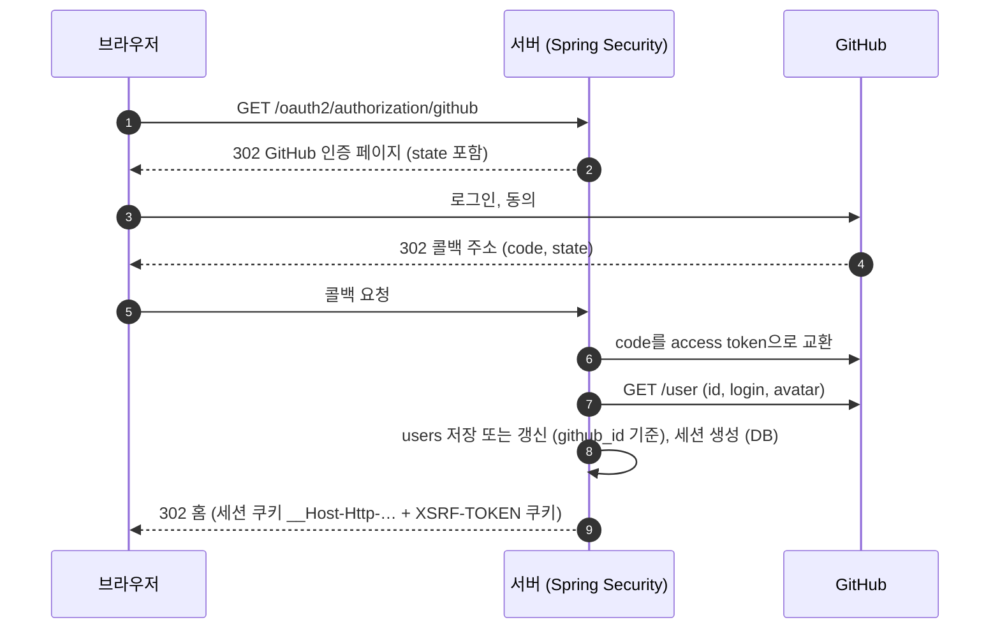

# API와 권한

> 스펙 문서예요. 사람이 정한 내용만 담아요. 에이전트는 사람이 정한 결정을 `docs/` 브랜치의 문서 전용 PR로 반영하고, 그 밖에 바꿀 게 있으면 PR의 '스펙 변경 제안'에 적어요 (`docs/workflow.md` 4장).
>
> - 4.4의 '단계' 열은 P1~P3예요. 어느 작업 단계(S번호)에서 만드는지는 `docs/steps/README.md`에 있어요.
> - 4.5의 로그인 유지 방식은 OD-01로 확정됐어요 (결정 제안서 002). GitHub 로그인 방식은 OD-02로 확정됐어요 (웹훅용 GitHub App의 사용자 인증, 결정 제안서 005).
> - 응답 본문의 모양은 표에 없어요. 엔드포인트를 만드는 단계에서 정하고, PR 판단 기록에 '꼭 봐 주세요'로 남겨요. 프론트가 이 계약을 써요.

## 4.4 API

권한 표기: 공개 / 로그인 / 멤버 / 방장 / 서명 (웹훅)

| 메서드·경로                                      | 용도                                     | 권한      | 단계 |
|--------------------------------------------------|------------------------------------------|-----------|------|
| `GET /api/me`                                    | 내 정보, 연결된 레포, 알림 구독 상태     | 로그인    | P1   |
| `POST /logout`                                   | 로그아웃                                 | 로그인    | P1   |
| `DELETE /api/me`                                 | 탈퇴                                     | 로그인    | P1   |
| `POST /api/studies`                              | 스터디 만들기 (규칙, 첫 기수 포함)       | 로그인    | P1   |
| `GET /api/studies`                               | 내 스터디 목록                           | 로그인    | P1   |
| `GET /api/studies/{id}`                          | 스터디 상세 (현재 규칙, 기수)            | 멤버      | P1   |
| `PATCH /api/studies/{id}`                        | 이름, 방장 위임                          | 방장      | P1   |
| `PUT /api/studies/{id}/rules`                    | 규칙 변경 (다음 스터디 일부터)           | 방장      | P1   |
| `POST /api/studies/{id}/invitations`             | 초대 링크 만들기                         | 방장      | P1   |
| `GET /api/invitations/{token}`                   | 초대 미리보기 (규칙 요약)                | 공개      | P1   |
| `POST /api/invitations/{token}/accept`           | 초대 수락                                | 로그인    | P1   |
| `DELETE /api/studies/{id}/members/me`            | 탈퇴                                     | 멤버      | P1   |
| `DELETE /api/studies/{id}/members/{userId}`      | 멤버 내보내기                            | 방장      | P2   |
| `GET /api/studies/{id}/today`                    | 오늘 현황 (멤버별)                       | 멤버      | P1   |
| `GET /api/studies/{id}/days/{date}`              | 특정 날 상세                             | 멤버      | P1   |
| `GET /api/github/install-url`                    | App 설치 주소 (1회용 state 포함)         | 로그인    | P1   |
| `GET /github/setup`                              | 설치 후 돌아오는 화면 (연결 상태 안내만) | 로그인    | P1   |
| `GET /api/me/github/repositories`                | 설치된 레포 목록                         | 로그인    | P1   |
| `PUT /api/me/linked-repository`                  | 풀이 레포 선택                           | 로그인    | P1   |
| `GET /api/me/solves?from=&to=`                   | 내 풀이 (확인 대기 포함)                 | 로그인    | P1   |
| `PATCH /api/me/solves/{id}`                      | 확인 대기 풀이에 문제 지정               | 본인      | P1   |
| `POST /api/studies/{id}/self-reports`            | 수동 인증                                | 멤버      | P1   |
| `DELETE /api/studies/{id}/self-reports/{rid}`    | 수동 인증 철회 (판정 전)                 | 본인      | P1   |
| `POST /api/studies/{id}/exemptions`              | 면제권 사용                              | 멤버      | P1   |
| `DELETE /api/studies/{id}/exemptions/{studyDay}` | 면제권 취소                              | 본인      | P1   |
| `GET /api/studies/{id}/share-card?type=today`    | 공유 카드 내용                           | 멤버      | P1   |
| `GET /api/push/vapid-public-key`                 | 웹 푸시 공개키                           | 공개      | P1   |
| `POST /api/me/push-subscriptions`                | 푸시 구독 등록                           | 로그인    | P1   |
| `DELETE /api/me/push-subscriptions/{id}`         | 구독 해제                                | 본인      | P1   |
| `PUT /api/studies/{id}/channels/discord`         | 디스코드 웹훅 등록·해제                  | 방장      | P1   |
| `POST /api/studies/{id}/channels/discord/test`   | 테스트 게시                              | 방장      | P1   |
| `POST /webhooks/github`                          | GitHub 웹훅 수신                         | 서명      | P1   |
| `POST /api/studies/{id}/appeals`                 | 이의 신청                                | 멤버      | P2   |
| `POST /api/studies/{id}/appeals/{aid}/decision`  | 이의 결정                                | 방장      | P2   |
| `GET /api/studies/{id}/ledger?userId=`           | 원장 조회                                | 멤버      | P2   |
| `POST /api/studies/{id}/ledger/entries`          | 납부·보증금·환급 기록                    | 방장      | P2   |
| `GET /api/studies/{id}/settlements?period=`      | 주간·기수 정산                           | 멤버      | P2   |
| `POST /api/studies/{id}/seasons/next/confirm`    | 다음 기수 이어가기 응답                  | 멤버      | P3   |
| `GET /api/studies/{id}/stats`                    | 스트릭·통계                              | 멤버      | P3   |
| `POST /webhooks/discord`                         | 디스코드 명령 수신                       | 서명      | P3   |
| `POST /webhooks/kakao-share`                     | 카톡 공유 결과 수신 (선택)               | 확인 헤더 | P3   |
| `GET /actuator/health`                           | 헬스체크 (외부 노출은 이것만)            | 공개      | P1   |

- 오류 응답은 `application/problem+json`(RFC 9457) 형식으로 통일해요. Spring Boot 3의 `ProblemDetail`을 써요.
- springdoc-openapi로 명세를 자동 생성하고, 이 명세로 프론트의 API 클라이언트를 만들어요 (7장).
- 목록 API는 전부 페이지네이션해요 (Supabase egress 보호, 9.4).

## 4.5 로그인과 권한

**만들 것**

- Spring Security OAuth2 Client로 GitHub 로그인 (웹훅용 GitHub App의 사용자 인증, 결정 제안서 005). GitHub의 access token은 신원 확인에만 쓰고 저장하지 않아요.
- Spring Session JDBC로 세션을 DB에 저장 (D22). 세션 쿠키는 HttpOnly, Secure, SameSite=Lax이고 이름은 `__Host-Http-` 접두사로 시작해요 (로컬 개발·브라우저 지원이 안 되면 `__Host-`, 결정 제안서 002)
- CSRF: 토큰을 쿠키로 내려주고, SPA가 `X-XSRF-TOKEN` 헤더로 돌려보내는 방식
- 권한 검사는 한 곳 (`StudyAccess`)에 모으고 모든 API에 적용
- 관리자 기능 (`/admin/**`)은 Cloudflare Access (무료, 50명까지) 뒤에 두고 앱에서도 역할 확인

**주의할 것**

- Spring Security 6부터 CSRF 토큰 처리 방식이 바뀌었어요. SPA는 공식 문서의 'Single-Page Applications' 설정을 그대로 따르세요. 대충 하면 POST가 전부 403이 나요.
- 웹훅 경로 (`/webhooks/**`)는 CSRF와 세션에서 빼고, 서명으로만 인증해요.
- **조회 쿼리도 스터디 ID로 범위를 묶어요.** 권한 검사를 통과해도 쿼리가 `id`만으로 찾으면 다른 스터디 데이터가 섞일 수 있어요 (IDOR).
- 세션 만료는 30일 롤링으로 해요. 길수록 편하지만 탈취 위험이 커지는 트레이드오프예요. 선택지 비교와 결정은 결정 제안서 002에 있어요.

**권한 표**

| 동작                             | 비회원 | 멤버                       | 방장 | 비고              |
|----------------------------------|--------|----------------------------|------|-------------------|
| 스터디·오늘 현황 보기            | –      | ✓                         | ✓   |                   |
| 초대 링크 만들기, 규칙·채널 변경 | –      | –                          | ✓   |                   |
| 수동 인증, 면제권                | –      | 본인                       | 본인 |                   |
| 이의 신청                        | –      | 본인 판정 / 남의 수동 인증 | 같음 |                   |
| 이의 결정                        | –      | –                          | ✓   | 본인 관련 건은 Q4 |
| 납부·보증금·환급 기록            | –      | –                          | ✓   |                   |
| 멤버 내보내기, 방장 위임         | –      | –                          | ✓   |                   |
