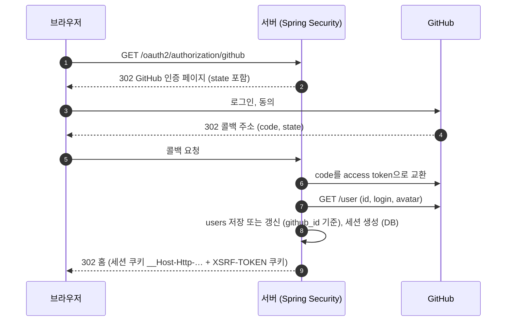

# API와 권한

> 스펙 문서예요. 사람이 정한 내용만 담아요. 에이전트는 사람이 정한 결정을 `docs/` 브랜치의 문서 전용 PR로 반영하고, 그 밖에 바꿀 게 있으면 PR의 '스펙 변경 제안'에 적어요 (`docs/workflow.md` 4장).
>
> - 4.4의 '단계' 열은 P1~P3예요. '미정'은 어느 단계에서 만들지 아직 정하지 않은 것이에요. 어느 작업 단계(S번호)에서 만드는지는 `docs/steps/README.md`에 있어요.
> - 4.5의 로그인 유지 방식은 OD-01로 확정됐어요 (결정 제안서 002). GitHub 로그인 방식은 OD-02로 확정됐어요 (웹훅용 GitHub App의 사용자 인증, 결정 제안서 005).
> - 응답 본문의 모양은 표에 없어요. 엔드포인트를 만드는 단계에서 정하고, PR 판단 기록에 '꼭 봐 주세요'로 남겨요. 프론트가 이 계약을 써요.

## 4.4 API

권한 표기: 공개 / 로그인 / 멤버 / 방장 / 서명 (웹훅)

| 메서드·경로                                      | 용도                                     | 권한      | 단계 |
|--------------------------------------------------|------------------------------------------|-----------|------|
| `GET /api/me`                                    | 내 정보, 연결된 레포                     | 로그인    | P1   |
| `POST /logout`                                   | 로그아웃                                 | 로그인    | P1   |
| `DELETE /api/me`                                 | 탈퇴                                     | 로그인    | P1   |
| `POST /api/studies`                              | 스터디 만들기 (규칙, 첫 기수 포함)       | 로그인    | P1   |
| `GET /api/studies`                               | 내 스터디 목록                           | 로그인    | P1   |
| `GET /api/studies/{id}`                          | 스터디 상세 (현재 규칙, 예정된 변경, 기수) | 멤버      | P1   |
| `PATCH /api/studies/{id}`                        | 이름, 방장 위임                          | 방장      | P1   |
| `PUT /api/studies/{id}/rules`                    | 규칙 변경 (기준 버전 ID + 규칙 전체. 다음 스터디 일부터, 일부 항목은 다음 기수부터, R2) | 방장      | P1   |
| `POST /api/studies/{id}/invitations`             | 초대 링크 만들기                         | 방장      | P1   |
| `GET /api/invitations/{token}`                   | 초대 미리보기 (규칙 요약, 예정된 변경)   | 공개      | P1   |
| `POST /api/invitations/{token}/accept`           | 초대 수락                                | 로그인    | P1   |
| `DELETE /api/studies/{id}/members/me`            | 탈퇴                                     | 멤버      | P1   |
| `DELETE /api/studies/{id}/members/{userId}`      | 멤버 내보내기                            | 방장      | P2   |
| `GET /api/studies/{id}/today`                    | 오늘 현황 (멤버별)                       | 멤버      | P1   |
| `GET /api/studies/{id}/days/{date}`              | 특정 날 상세                             | 멤버      | P1   |
| `GET /api/github/install-url`                    | App 설치 주소 (1회용 state 포함)         | 로그인    | P1   |
| `GET /github/setup`                              | 설치 후 돌아오는 화면 (연결 상태 안내만) | 로그인    | P1   |
| `GET /api/me/github/repositories`                | 설치된 레포 목록                         | 로그인    | P1   |
| `PUT /api/me/linked-repository`                  | 풀이 레포 선택                           | 로그인    | P1   |
| `GET /api/me/solves?from=&to=&status=`           | 내 풀이 (확인 대기 포함)                 | 로그인    | P1   |
| `PATCH /api/me/solves/{id}`                      | 확인 대기 풀이에 문제 지정               | 본인      | P1   |
| `POST /api/studies/{id}/self-reports`            | 수동 인증                                | 멤버      | P1   |
| `DELETE /api/studies/{id}/self-reports/{rid}`    | 수동 인증 철회 (판정 전)                 | 본인      | P1   |
| `GET /api/studies/{id}/self-reports?status=PENDING_APPROVAL` | 승인 대기 수동 인증 ('승인 필요' 모드) | 방장 | 미정 |
| `POST /api/studies/{id}/self-reports/{rid}/approve` | 수동 인증 승인 ('승인 필요' 모드)    | 방장      | 미정 |
| `POST /api/studies/{id}/self-reports/{rid}/reject` | 수동 인증 거부 ('승인 필요' 모드)     | 방장      | 미정 |
| `POST /api/studies/{id}/exemptions`              | 면제권 사용                              | 멤버      | P1   |
| `DELETE /api/studies/{id}/exemptions/{studyDay}` | 면제권 취소                              | 본인      | P1   |
| `GET /api/studies/{id}/share-card?type=today`    | 공유 카드 내용                           | 멤버      | P1   |
| `GET /api/push/vapid-public-key`                 | 웹 푸시 공개키                           | 공개      | P1   |
| `POST /api/me/push-subscriptions`                | 푸시 구독 등록                           | 로그인    | P1   |
| `GET /api/me/push-subscriptions?page=&size=`     | 내 푸시 구독(기기) 목록                  | 로그인    | P1   |
| `DELETE /api/me/push-subscriptions/{id}`         | 구독 해제                                | 본인      | P1   |
| `PUT /api/studies/{id}/channels/discord`         | 디스코드 웹훅 등록·해제                  | 방장      | P1   |
| `POST /api/studies/{id}/channels/discord/test`   | 테스트 게시                              | 방장      | P1   |
| `POST /webhooks/github`                          | GitHub 웹훅 수신                         | 서명      | P1   |
| `POST /api/studies/{id}/appeals`                 | 이의 신청                                | 멤버      | P2   |
| `POST /api/studies/{id}/appeals/{aid}/decision`  | 이의 결정                                | 방장      | P2   |
| `GET /api/studies/{id}/ledger?userId=`           | 원장 조회                                | 멤버      | P2   |
| `POST /api/studies/{id}/ledger/entries`          | 납부·보증금·환급 기록                    | 방장      | P2   |
| `GET /api/studies/{id}/settlements?period=`      | 주간·기수 정산                           | 멤버      | P2   |
| `POST /api/studies/{id}/seasons/next/confirm`    | 다음 기수 이어가기 응답                  | 멤버      | P3   |
| `GET /api/studies/{id}/stats`                    | 스트릭·통계                              | 멤버      | P3   |
| `POST /webhooks/discord`                         | 디스코드 명령 수신                       | 서명      | P3   |
| `POST /webhooks/kakao-share`                     | 카톡 공유 결과 수신 (선택)               | 확인 헤더 | P3   |
| `GET /actuator/health`                           | 헬스체크 (외부 노출은 이것만)            | 공개      | P1   |

- 오류 응답은 `application/problem+json`(RFC 9457) 형식으로 통일해요. Spring의 `ProblemDetail`을 써요.
    - 화면이 갈라 처리해야 하는 오류에는 확장 속성 `code`(대문자 스네이크)를 둬요. `detail` 문장은 바뀔 수 있어도 `code`는 바꾸지 않아요. 구분은 `type` URI가 아니라 `code`로 하고, `type`은 `about:blank` 그대로예요 (사람이 정함, 2026-11-26 S10 PR #26).
    - 지금 있는 값 (모두 409):
        - `STUDY_DAY_JUDGED`: 판정된 날에 풀이를 더하려 함. 확인 대기 지정(`PATCH /api/me/solves/{id}`, R6. 유예 안에 받았고 R4의 전날 후보인 전날이 실패로 판정된 경우 포함)과 수동 인증 제출. 화면은 이때만 이의 안내를 보여 줘요
        - `SOLVE_NOT_PENDING`: 확인 대기가 아님 / `PROBLEM_ALREADY_IN_COMMIT`: 같은 커밋에 그 문제가 이미 있음 (확인 대기 지정)
        - `SELF_REPORT_DAILY_LIMIT`: 하루 6건째 / `SELF_REPORT_APPROVAL_UNSUPPORTED`: '승인 필요' 스터디 / `PROBLEM_ALREADY_COUNTED`: 그날 이미 센 문제 / `PREVIOUS_DAY_NOT_OPEN`: 유예 중 전날에 R4가 보내지 않음(판정 대상 아님, 쉬는 날, 면제권 씀, 목표 채움), 오늘로 내야 함 (수동 인증 제출, R7)
        - `SELF_REPORT_NOT_ACCEPTED`: 인정 상태가 아님(이미 철회함 등) / `SELF_REPORT_DAY_JUDGED`: 판정된 날의 수동 인증 철회 (이의 안내 없음) / `SAME_PROBLEM_PUSHED_IN_GRACE`: 같은 문제의 풀이(수동 인증 아님)를 다음 날 유예 안에 받아 철회하면 그날 센 문제가 줆 (수동 인증 철회, R7)
        - `GOAL_ALREADY_MET`: 목표를 채운 날 / `EXEMPTION_LIMIT_REACHED`: 이번 기수 면제권을 다 씀 (면제권 사용)
    - S11의 값과 응답 모양은 S11 PR #29에서 정했어요 (`code` 이름은 에이전트가 정했고, 사람이 스펙 반영을 정함, 2026-11-26).
- springdoc-openapi로 명세를 자동 생성하고, 이 명세로 프론트의 API 클라이언트를 만들어요 (7장).
- 목록 API는 전부 페이지네이션해요 (Supabase egress 보호, 9.4).
- **내 풀이 (`GET /api/me/solves`):** `status`는 선택이고, 풀이 기록 상태(`CONFIRMED`·`PENDING_IDENTIFICATION`·`IGNORED`) 하나로 걸러요. 모르는 값은 400이에요. `from`·`to`·페이지와 함께 쓸 수 있어요. 화면 7번은 확인 대기만 모아 볼 때 `status=PENDING_IDENTIFICATION`을 써요 (사람이 정함, 2026-11-26 S10 PR #26).
- **수동 인증 (`/api/studies/{id}/self-reports`, R7, S11):**
    - 제출 본문은 `studyDay`(오늘 또는 유예 중 전날), `platform`, `problemNo`, `evidenceUrl`(선택, `http`·`https`, 2000자까지), `memo`(선택, 500자까지)예요. 201과 `{id, studyId, studyDay, platform, problemNo, evidenceUrl, memo, status, createdAt}`을 줘요.
    - 기한 밖 날·형식 오류·`http`·`https`가 아닌 링크는 400, 멤버가 아니면 404예요.
    - 철회는 204예요. 남의 것·다른 스터디의 것·없는 것, 지금 그 스터디의 멤버가 아니면 404예요.
    - 승인 API(위 표 '미정' 세 줄)는 '승인 필요' 모드에 필요한 계약으로 열어 둬요 (알려진 충돌 6번). 맡을 단계와, 승인할 때 그날이 이미 판정됐으면 어떻게 할지는 정하지 않았어요.
- **면제권 (`/api/studies/{id}/exemptions`, R8, OD-09, S11):**
    - 사용 본문은 `studyDay`(오늘이어야 함)예요. 사용과 취소 모두 200과 `{studyDay, exemptionUsed, exemptionsPerSeason, exemptionsRemaining}`을 줘요. 같은 날 다시 써도, 쓰지 않은 날을 취소해도 200이에요.
    - 사용: 오늘이 아닌 날·쉬는 날·판정하지 않는 날은 400이에요. 취소: 오늘이 아닌 날만 400이에요. 둘 다 멤버가 아니면 404예요.
    - `exemptionsRemaining`은 그날이 기수 밖이면 `null`이에요 (기수 밖에서는 쓸 수 없으니 취소 응답에서만 생겨요).
- **현황의 면제권·수동 인증 (`/today`, `/days/{date}`, S11):** `members[]`에 두 값이 있어요.
    - `exemptionsRemaining`: 그날이 속한 기수에 지금 남은 면제권이에요. 모든 멤버에게 보여요. 기수 밖이면 `null`이에요.
    - `selfReportRatio`: 그날이 속한 기수에 센 풀이 중 인정된 수동 인증의 비율(0~1)이에요. 방장이 볼 때만 값이 있고 아니면 `null`이에요. 기수 밖이거나 센 풀이가 없어도 `null`이에요.
- **현황의 정산 표시 (`/today`, `/days/{date}`, S12):** P1 '미인증 횟수 × 금액 표시'(2.3)예요. 모든 멤버에게 멤버마다 보여요 (사람이 정함, 2026-11-27 S12, 알려진 충돌 9번).
    - 최상위 `penaltyType`: 그날 규칙의 벌금 방식(`NONE`·`FINE`·`DEPOSIT_REFUND`)이에요. 한 기수 안에서는 같아요 (R2).
    - 최상위 `fineAmount`: 실패 한 번의 금액(원)이에요. `NONE`이면 `null`이에요.
    - `members[]`의 `failCount`: 그날이 속한 기수에 실패로 판정된 날 수(지금까지)예요. `fineTotal`은 `failCount × fineAmount`예요. 보증금 환급 방식도 같은 계산이고 보증금에서 깎일 금액이에요. 벌금 방식이 `NONE`이거나 그날이 기수 밖이면 둘 다 `null`이에요.
- **규칙 변경과 규칙 버전 (`PUT /api/studies/{id}/rules`, 스터디 상세, 초대 미리보기):** S05(PR #21)에서 정한 응답 모양 가운데 프론트가 꼭 알아야 하는 규칙 버전 부분이에요. 나머지 응답 모양은 머리말대로 단계 PR의 판단 기록에 있어요.
    - 본문은 그 값을 채울 때 출발한 규칙 버전의 ID(`basedOnRuleId`, 필수)와 규칙 열 항목 전체(R1 표)예요. 바꿀 항목만 보내지 않아요. 빠지거나 범위 밖이면 400이에요.
    - `basedOnRuleId`가 마지막 버전(예정된 변경이 있으면 마지막 예정 버전)이 아니면 409예요. 화면이 현재 규칙으로 채워 보내 예정된 변경을 모르고 지우거나, 다른 탭·새 방장이 바꾼 규칙을 덮어쓰는 일을 막아요. 예정 버전은 바꿀 때마다 새 ID가 돼서, 409를 받으면 다시 불러와야 해요.
    - 1기 시작 전에 하루 기준 시각을 앞당겨 1기 첫날이 이미 시작된 것이 되면 409예요 (R2).
    - 권한을 먼저 봐요. 기준 버전 ID가 틀려도 멤버는 403, 멤버가 아니면 404예요.
    - 응답은 스터디 상세예요. 스터디 상세의 `rule`(현재 규칙)과 `upcomingRules[]`(예정된 변경, 적용 시작일 순서, 없으면 `[]`)에는 버전 `id`가 있어요.
    - 초대 미리보기의 `upcomingRules[]`에는 적용 시작일과 규칙 요약만 있어요 (버전 ID·알림 시각 없음).
- **웹 푸시 구독 (`/api/push/vapid-public-key`, `/api/me/push-subscriptions`, 5.8, S13):** S13 PR #35에서 정한 모양이에요 (에이전트가 정했고, 사람이 스펙 반영을 정함, 2026-11-28). 내 구독 목록은 `GET /api/me`의 '알림 구독 상태' 대신이에요 (사람이 정함, 2026-11-28 S13).
    - 공개키: 200과 `{publicKey}`예요. 압축하지 않은 P-256 공개키(65바이트)의 base64url이라 브라우저 `pushManager.subscribe`의 `applicationServerKey`에 그대로 넣어요. 로그인 없이 읽어요.
    - 등록: 본문은 브라우저 `PushSubscription.toJSON()` 그대로 `{endpoint, expirationTime, keys: {p256dh, auth}}`예요(`expirationTime`은 받기만 하고 쓰지 않음). 기기 구분 표시용으로 요청의 `User-Agent`를 512자까지 남겨요. 201과 `{id, createdAt}`을 줘요.
        - 같은 `endpoint`를 다시 등록해도 201이고 같은 `id`예요. 다른 사용자가 등록한 주소면 지금 사용자로 옮기고 키를 바꿔요 (data-model '알림 테이블').
        - 주소가 알려진 푸시 서비스가 아니거나(9.7, T28) 키 형식이 틀리면 400이에요.
    - 내 구독 목록: 로그인한 사용자의 구독만 ID 순서로 줘요. `GET /api/me/solves`와 같은 페이지 모양(Spring `PagedModel`)이에요. `content[]`에 `{id, createdAt, lastSuccessAt, userAgent}`, `page`에 크기·번호·전체 수가 있어요. `page`는 0부터(기본 0), `size`는 기본 20·최대 50이고 범위 밖이면 400이에요.
        - 구독 주소(`endpoint`)와 키는 내보내지 않아요. 기기를 가리키는 비밀 주소예요 (9.8 최소 노출). 화면이 '이 기기'를 알려면 등록 응답의 `id`를 저장해 써요.
    - 해제: 204예요. 남의 것이나 없는 것은 404예요 (T19).

## 4.5 로그인과 권한

**만들 것**

- Spring Security OAuth2 Client로 GitHub 로그인 (웹훅용 GitHub App의 사용자 인증, 결정 제안서 005). GitHub의 access token은 신원 확인에만 쓰고 저장하지 않아요.
- Spring Session JDBC로 세션을 DB에 저장 (D22). 세션 쿠키는 HttpOnly, Secure, SameSite=Lax이고 이름은 `__Host-Http-` 접두사로 시작해요 (로컬 개발·브라우저 지원이 안 되면 `__Host-`, 결정 제안서 002)
- CSRF: 토큰을 쿠키로 내려주고, SPA가 `X-XSRF-TOKEN` 헤더로 돌려보내는 방식
- 권한 검사는 한 곳 (`StudyAccess`)에 모으고 모든 API에 적용
- 관리자 기능 (`/admin/**`)은 Cloudflare Access (무료, 50명까지) 뒤에 두고 앱에서도 역할 확인

**주의할 것**

- Spring Security 6부터 CSRF 토큰 처리 방식이 바뀌었어요. SPA는 공식 문서의 'Single-Page Applications' 설정을 그대로 따르세요. 대충 하면 POST가 전부 403이 나요.
- 웹훅 경로 (`/webhooks/**`)는 CSRF와 세션에서 빼고, 서명으로만 인증해요.
- **조회 쿼리도 스터디 ID로 범위를 묶어요.** 권한 검사를 통과해도 쿼리가 `id`만으로 찾으면 다른 스터디 데이터가 섞일 수 있어요 (IDOR).
- 세션 만료는 30일 롤링으로 해요. 길수록 편하지만 탈취 위험이 커지는 트레이드오프예요. 선택지 비교와 결정은 결정 제안서 002에 있어요.

**권한 표**

| 동작                             | 비회원 | 멤버                       | 방장 | 비고              |
|----------------------------------|--------|----------------------------|------|-------------------|
| 스터디·오늘 현황 보기            | –      | ✓                         | ✓   |                   |
| 초대 링크 만들기, 규칙·채널 변경 | –      | –                          | ✓   |                   |
| 수동 인증, 면제권                | –      | 본인                       | 본인 |                   |
| 이의 신청                        | –      | 본인 판정 / 남의 수동 인증 | 같음 |                   |
| 이의 결정                        | –      | –                          | ✓   | 본인 관련 건은 Q4 |
| 납부·보증금·환급 기록            | –      | –                          | ✓   |                   |
| 멤버 내보내기, 방장 위임         | –      | –                          | ✓   |                   |
