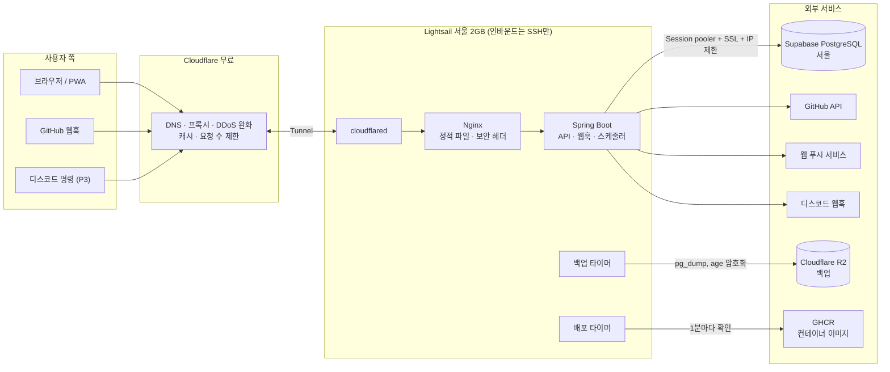
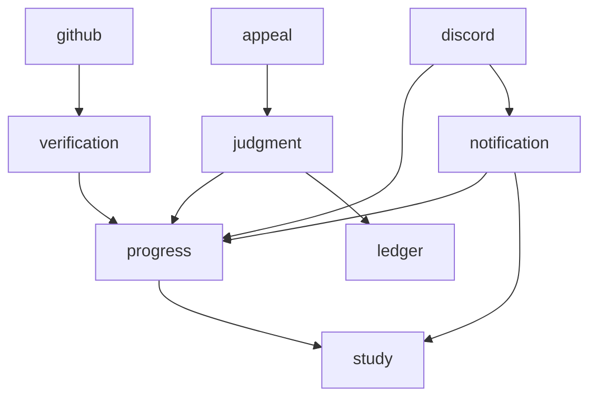

# 시스템 구조

> 스펙 문서예요. 사람이 정한 내용만 담아요. 에이전트는 사람이 정한 결정을 `docs/` 브랜치의 문서 전용 PR로 반영하고, 그 밖에 바꿀 게 있으면 PR의 '스펙 변경 제안'에 적어요 (`docs/workflow.md` 4장).
>
> - 4.2의 의존 규칙은 ArchUnit 테스트로 강제해요 (S01에서 만듦).
> - 배포·보안·비용은 `docs/spec/infra.md`(9장)와 `docs/spec/security.md`에 있어요.
> - 문서 끝의 '알려진 충돌과 빈 곳'을 먼저 읽어요. 계획서끼리 맞지 않는 곳이에요.

## 4.1 구성도



- **같은 도메인 아래 경로로 나눠요.** Nginx가 `/`에서 프론트 정적 파일을 주고, `/api/*`, `/oauth2/*`, `/login/*`, `/webhooks/*`는 Spring으로 넘겨요.
  브라우저 입장에서 출처가 하나라 CORS가 필요 없고 세션 쿠키를 그대로 써요.
- **서버 한 대 안에서 역할을 나눠요.** API, 웹훅 수신, 스케줄러 (판정·알림·복구)가 한 프로세스에 있어요. 나중에 서버가 2대가 되어도 스케줄러가 한 번만 돌도록 처음부터 ShedLock을 써요.
- 배포·보안·비용의 자세한 내용은 9장에 있어요.

## 4.2 모듈 구조 (모듈러 모놀리스)

```
com.(이름).studybot
├── auth/            로그인, 세션, 현재 사용자, 탈퇴
├── study/           스터디, 규칙(버전), 기수, 초대, 멤버십
├── github/          App 설치 연결, 웹훅 수신, inbox, GitHub API 클라이언트, 누락 복구
├── verification/    풀이 기록, 문제 식별 파서, 수동 인증
│   └── source/      인증 수단 인터페이스 (GitHub / 수동 / 나중에 다른 수단)
├── progress/        스터디 일 배정, 멤버 일(진행·판정 결과), 면제권
├── judgment/        판정 배치, 판정 정정
├── ledger/          원장, 정산 (P2)
├── appeal/          이의 (P2)
├── notification/    알림 생성·발송(outbox), 웹 푸시, 디스코드 웹훅, 공유 카드
├── discord/         디스코드 명령 (P3)
└── common/          Clock, StudyCalendar(시간 계산), 오류 형식, 보안 유틸
```



**규칙**

- 화살표 방향으로만 의존해요. 반대 방향 통지 (예: "목표 달성됨 → 알림 대상에서 제외")는 트랜잭션 커밋 뒤에 발행하는 이벤트로 해요.
- **진실의 원천은 DB 상태예요.** 이벤트는 최적화일 뿐이라, 서버가 죽어 이벤트가 사라져도 배치가 다시 계산해서 맞춰야 해요.
- 다른 모듈의 엔티티를 직접 수정하지 않고, 공개된 서비스 메서드로만 접근해요.
- 이 규칙은 ArchUnit 테스트로 CI에서 강제해요.
- 시간 계산은 전부 `common`의 `StudyCalendar` 한 곳에서 해요. 기준 시각, 유예, 알림 시각, 판정 시각 계산이 여기저기 흩어지면 버그가 나요.
- 다른 모듈의 엔티티를 직접 수정하지 않고, 공개된 서비스 메서드로만 접근해요.
  - 모듈의 공개 API는 모듈 루트 패키지(예: `study`)에 둬요. 하위 패키지(예: `study.persistence`)는 그 모듈 안에서만 쓰고, 엔티티와 저장소는 하위 패키지에 둬요. (결정 001 ①)
  - 그래프에 직접 그려진 화살표만 허용해요. `github → verification → progress`여도 `github`가 `progress`를 바로 쓰지 않아요. 새 의존이 필요하면 스펙 변경 제안으로 화살표를 먼저 더해요. (결정 001 ②)
  - 모든 모듈은 `common`과 `auth`의 공개 API를 쓸 수 있어요. `common`은 다른 모듈에 의존하지 않고 하위 패키지까지 모두 공개예요. `auth`는 `common`에만 의존해요. (결정 001 ③)

## 기술 스택 (D2)

| 영역 | 선택 | 상태 |
|---|---|---|
| 언어 | Java 25 (Gradle toolchain) | 확정 |
| 프레임워크 | Spring Boot 4.1.x (첫 커밋 기준 4.1.3), Spring MVC | 확정. 4.2.x로 올리는 건 사람이 정함 |
| 영속성 | Spring Data JPA (Hibernate 7), PostgreSQL 17, Flyway | 확정. 운영 DB는 Supabase (D11) |
| 빌드 | Gradle 9.9.2, Groovy DSL (`build.gradle`) | 확정 |
| 테스트 | JUnit 5, AssertJ, Spring Boot Test, Testcontainers 2 (`postgres:17`, `@ServiceConnection`), MockMvc | 확정 |
| 테스트 (추가 예정) | ArchUnit (S01), WireMock (외부 API 단계), Awaitility (비동기 단계) | 필요한 단계에서 추가 |
| 로그인 | Spring Security OAuth2 Client (GitHub) | 확정. 세부 방식은 OD-02 |
| 세션 | Spring Session JDBC (계획서 기본안, D22) | OD-01 |
| 스케줄러 잠금 | ShedLock (JDBC) | 확정 (4.1). 첫 스케줄러 단계(S12)에서 추가 |
| API 명세 | springdoc-openapi (Boot 4 지원 계열) | 확정 (4.4) |
| 요청 수 제한 | Bucket4j 등 (9.7) | 구현 단계에서 판단 기록 |
| 웹 푸시 | 라이브러리 미정 | OD-11 |
| Redis | 쓰지 않음 (계획서) | OD-03 |
| QueryDSL | 쓰지 않음, 조회 전용 DTO 쿼리 (계획서) | OD-04 |
| Lombok | 미정 | OD-05 |

**Boot 4에서 자주 틀리는 것.** 인터넷 예제와 AI가 만드는 코드는 Spring Boot 3.x 기준이 많아요. 아래는 공식 마이그레이션 가이드로 확인하고 써요.

- 스타터 이름이 기술별로 나뉘었어요 (예: `spring-boot-starter-webmvc`, `spring-boot-starter-flyway`, 테스트용 `-test` 스타터).
- Jackson 3을 써요. 패키지가 `tools.jackson`으로 바뀌었고, 어노테이션 패키지는 바뀌지 않은 것도 있어요. 일괄 치환하지 말고 확인해요.
- Hibernate 7, Testcontainers 2(`org.testcontainers.postgresql.PostgreSQLContainer`)를 써요.
- 라이브러리를 더할 때는 Boot 4 지원 버전인지 확인하고, Boot BOM이 관리하지 않는 의존성만 버전을 적어요.


## 6. 깊게 다룰 기술 과제 6가지

이 서비스의 기술적 핵심이에요. 과제마다 **결정 기록 1개 + 검증 결과 (테스트나 측정)**가 완료 기준이에요.

| # | 과제                                       | 문제                                                                                              | 설계                                                                                                                    | 검증·남길 증거                                                                                                          | 관련                     |
|---|--------------------------------------------|---------------------------------------------------------------------------------------------------|-------------------------------------------------------------------------------------------------------------------------|-------------------------------------------------------------------------------------------------------------------------|--------------------------|
| ① | **외부 이벤트를 놓치지 않고 한 번만 처리** | GitHub는 10초 안에 응답해야 하고 재시도하지 않음 [S33][S34]. 디스코드는 3초 [S31]                 | 소스별 서명 검증기 + 공통 inbox(delivery_id UNIQUE) + 빠른 응답 + 비동기 처리 + 재전송·대조                             | 중복 수신 시 1건, 서명 위조 거절, 처리 중 재시작해도 결과 같음. **P1(동기) 대비 P2(inbox)의 처리 지연, 누락 복구 건수** | 5.3, 5.14, 5.15, ADR-005 |
| ② | **시간 규칙과 판정 배치**                  | 기준 시각, 유예, 시간대, 규칙 버전, 서버 다운 뒤 따라잡기, 늦은 풀이와 경합                       | `StudyCalendar` 하나로 시간 계산, 멤버 일 행 잠금, 진행 지점(last_judged_day), 멱등 판정                                | 고정 `Clock` 경계값 테스트, 배치 2번 실행, 사흘 다운 시나리오                                                           | 5.5, 5.10, ADR-006       |
| ③ | **원장 정합성**                            | 정정·납부가 섞여도 잔액이 늘 맞아야 함                                                            | 추가만 하는 원장, 반대 기록, idempotency_key, 낙관적 락                                                                 | 동시 정정 테스트, 백필 2번 실행, '잔액 = 원장 합' 불변식 테스트                                                         | 5.11, 5.12, ADR-007      |
| ④ | **알림 신뢰성**                            | 외부 발송은 정확히 한 번이 불가능. 다운타임, 구독 만료, 한도                                      | outbox + dedupe_key + 발송 직전 재확인 + 재시도 + 만료                                                                  | 중복 생성 0, 발송 성공률, 410 정리 건수, **알림 전환율**                                                                | 5.8, ADR-004, ADR-008    |
| ⑤ | **JPA 모델링과 조회 성능**                 | 오늘 현황·정산 화면의 N+1, 판정 배치의 대량 조회                                                  | 조회 전용 DTO 쿼리, 인덱스(4.3), 배치는 스터디·날짜 단위 일괄 조회                                                      | 쿼리 수와 응답 시간 측정(전/후), 실행 계획, 데이터를 키운 측정                                                          | 4.3, 5.10                |
| ⑥ | **외부 의존 격리와 요청 한도**             | GitHub API, 푸시 서비스, 디스코드가 느리거나 실패해도 API는 정상이어야 함. 플랫폼 변화(백준 종료) | 인증 수단 인터페이스, 외부 호출 전용 스레드 풀, 타임아웃, 백오프 재시도, 요청 한도 관리(설치 토큰 시간당 5,000건 [S38]) | 외부 API를 느리게 만든 테스트에서 다른 API 응답 시간 유지. (선택) 일반 스레드 vs 가상 스레드 비교                       | 5.2, 5.8, 5.14           |


## 알려진 충돌과 빈 곳

계획서를 나누면서 찾은, 스펙끼리 맞지 않거나 비어 있는 곳이에요. 해당 단계에서 추측으로 채우지 말고 적힌 대로 기록을 남겨요.

| # | 내용 | 어디서 다루나 | 기록 |
|---|---|---|---|
| 1 | 4.2 그래프에 `auth`와 `common`의 관계가 없어요. 대부분의 모듈이 '현재 사용자'를 알아야 하고, `common`은 모두가 써요. | S01 | 결정 제안서 (해석과 ArchUnit 규칙) → **다룸:** [결정 001](../decisions/001-module-boundaries.md) 확정, 4.2 규칙에 반영 (PR #1) |
| 2 | 부록 D 판정 배치는 `createNotification(DAILY_RESULT)`를 직접 불러요. judgment와 notification 사이에는 화살표가 없어요. 4.2는 반대 방향 통지를 커밋 뒤 이벤트로 하라고 하지만, 이벤트가 사라져도 DB로 다시 맞출 수 있어야 해요. | S14 | 결정 제안서 |
| 3 | 계정 삭제(5.16)는 study, github, verification, notification의 데이터를 함께 지워요. 이 화살표들도 그래프에 없어요. | S15 | 결정 제안서 |
| 4 | 4.2는 `StudyCalendar`를 `common`에 두는데, 부록 D는 `StudyCalendar(study)`처럼 써요. `common`은 study 엔티티를 몰라야 하니 시간대와 규칙 값을 받아야 해요. | S02 | 판단 기록 |
| 5 | 규칙이 바뀌면 멤버에게 알려요(R2, 5.8 `RULE_CHANGED`). study → notification 방향이라 2번과 같은 문제예요. | S13 | 판단 기록 (2번과 같은 방식) |
| 6 | 수동 인증 '승인 필요' 모드(R7, 5.6)의 승인·거부 API가 4.4에 없어요. | S11 | 스펙 변경 제안. 승인되기 전에는 기본 모드(바로 인정)만 만듦 |
| 7 | 관리자를 어떻게 판별하는지 정해져 있지 않아요 (4.5, 5.17). | S15 | 결정 제안서 |
| 8 | springdoc 명세를 운영에서 노출할지 정해져 있지 않아요 (4.4, 9.7). | S01 | 판단 기록 → **다룸:** PR #1 판단 기록 'springdoc 명세의 노출 범위' (기본 꺼짐, 운영 배포도 끔) |
| 9 | P1 '미인증 횟수 × 금액 표시'(2.3)를 보여 줄 엔드포인트가 4.4에 없어요. | S12 | 판단 기록 (현황 응답에 포함하는 방식 등) |
| 10 | 면제권을 쓰면 '알림 대상에서 제외'(5.7)한다고 하지만, 별도 호출 대신 발송 직전 재확인(5.8)으로 충족돼요. 충돌은 아니고 해석이에요. | S11, S13 | 없음 |
