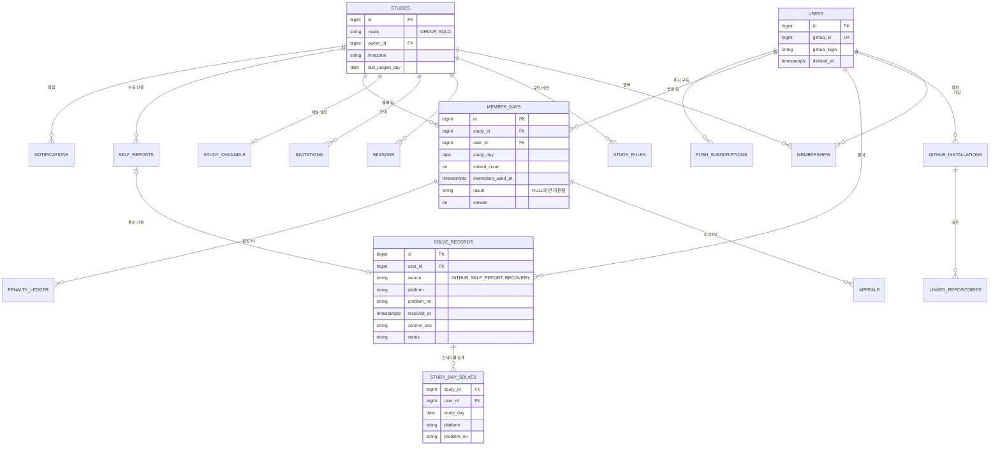

# 데이터 모델

> 스펙 문서예요. 사람이 정한 내용만 담아요. 에이전트는 사람이 정한 결정을 `docs/` 브랜치의 문서 전용 PR로 반영하고, 그 밖에 바꿀 게 있으면 PR의 '스펙 변경 제안'에 적어요 (`docs/workflow.md` 4장).
>
> - 테이블은 그 테이블이 필요한 단계에서 Flyway 마이그레이션으로 만들어요. 한꺼번에 미리 만들지 않아요.
> - 앱 테이블은 `studybot` 스키마에 둬요 (OD-06, 결정 제안서 004). 설정 방법은 첫 마이그레이션을 만드는 단계에서 판단 기록으로 정해요.
> - 표의 컬럼은 출발점이에요. 단계에서 컬럼을 더해야 하면 판단 기록에 남기고, 의미가 바뀌는 변경(제약, 상태 값, 컬럼 삭제)은 스펙 변경 제안으로 올려요.
> - 상태 값과 enum 이름은 `docs/spec/glossary.md`를 따라요.

## 4.3 데이터 모델 (PostgreSQL)

**테이블 상세**

| 테이블                                        | 단계 | 주요 컬럼                                                                                                                                                                                                         | 제약·비고                                                                      |
|-----------------------------------------------|------|-------------------------------------------------------------------------------------------------------------------------------------------------------------------------------------------------------------------|--------------------------------------------------------------------------------|
| `users`                                       | P1   | id, github_id, github_login, avatar_url, created_at, deleted_at                                                                                                                                                   | github_id UNIQUE, 탈퇴 전 필수 (CHECK). 탈퇴 시 익명화·deleted_at 채움 (5.16)  |
| `studies`                                     | P1   | id, name, mode(GROUP/SOLO), owner_id, timezone, status, last_judged_day, last_reminded_day, created_at                                                                                                            | 판정 배치(5.10)와 알림 생성(5.8)의 진행 지점                                   |
| `study_rules`                                 | P1   | id, study_id, effective_from, daily_goal, day_boundary, grace_minutes, rest_days, penalty_type, fine_amount, deposit_amount, exemptions_per_season, reminder_offset_minutes, self_report_mode, season_length_days | (study_id, effective_from) UNIQUE. 규칙 버전 (R2)                              |
| `seasons`                                     | P1   | id, study_id, seq, start_day, end_day, status, settling_started_at                                                                                                                                                | (study_id, seq) UNIQUE. 다음 기수 행은 이번 기수가 시작될 때 예정으로 만듦 (5.13). `settling_started_at`은 정산 중이 된 시각이고 정산 중·종료일 때는 늘 있고 그 밖에는 비어 있음(CHECK). + 72시간이 지나면 종료 (S12, V10) |
| `memberships`                                 | P1   | id, study_id, user_id, role(OWNER/MEMBER), joined_at, judged_from, left_at                                                                                                                                        | `(study_id, user_id) WHERE left_at IS NULL` 부분 UNIQUE → 탈퇴 후 재가입 가능  |
| `invitations`                                 | P1   | id, study_id, token_hash, expires_at, max_uses, used_count, revoked_at, created_by                                                                                                                                | token_hash UNIQUE. 토큰 원문은 저장하지 않음                                   |
| `github_installations`                        | P1   | installation_id, user_id, account_id, account_login, account_type, installed_by_owner, status(ACTIVE/SUSPENDED/DELETED), repositories_revision, created_at, updated_at, deleted_at                               | installation_id UNIQUE. user_id는 서명된 웹훅의 설치자로 연결 (5.2). 아래 'GitHub 연결 테이블' |
| `linked_repositories`                         | P1   | id, user_id, installation_id, repo_id, full_name, default_branch, path_prefix, status(ACTIVE/SUSPENDED/INACTIVE), created_at, updated_at                                                                         | `repo_id WHERE status='ACTIVE'` 부분 UNIQUE. 이름이 아니라 repo_id로 추적. 아래 'GitHub 연결 테이블' |
| `webhook_inbox`                               | P1   | id, source(GITHUB/DISCORD/KAKAO), delivery_id, event_type, payload(JSONB), received_at, status, attempts, next_attempt_at, last_error, processed_at                                                               | **(source, delivery_id) UNIQUE**. payload는 14일 뒤 비움 (NULL 허용, 행은 남음, S15) |
| `solve_records`                               | P1   | id, user_id, source, platform, problem_no, title, received_at, commit_sha, repo_id, inbox_id, raw_path, parser_version, status(CONFIRMED/PENDING_IDENTIFICATION/IGNORED)                                          | `(user_id, commit_sha, platform, problem_no)` UNIQUE, `(user_id, commit_sha, raw_path)` UNIQUE (둘 다 commit_sha 있을 때). 아래 '풀이 기록 테이블' |
| `study_day_solves`                            | P1   | id, study_id, user_id, study_day, solve_record_id, platform, problem_no                                                                                                                                           | **(study_id, user_id, study_day, platform, problem_no) UNIQUE** → R5. 아래 '멤버 일 테이블' |
| `member_days`                                 | P1   | id, study_id, user_id, study_day, season_id, solved_count, exemption_used_at, result, result_source, judged_at, rule_id, version                                                                                  | **(study_id, user_id, study_day) UNIQUE**. 잠금 대상이자 판정 결과 (5.5, 5.10). 아래 '멤버 일 테이블' |
| `self_reports`                                | P1   | id, study_id, user_id, study_day, platform, problem_no, evidence_url, memo, status, solve_record_id, decided_by, decided_at, created_at                                                                           | 하루 5건 제한 (R7). 아래 '수동 인증 테이블'                                     |
| `notifications`                               | P1   | id, type, channel, study_id, user_id, study_day, dedupe_key, payload(JSONB), status, attempts, next_attempt_at, locked_until, sent_at, expires_at, last_error, created_at                                         | **dedupe_key UNIQUE** → 같은 알림 중복 생성 방지 (5.8). 아래 '알림 테이블'      |
| `push_subscriptions`                          | P1   | id, user_id, endpoint, p256dh, auth, user_agent, created_at, last_success_at, failure_count                                                                                                                       | endpoint UNIQUE. 아래 '알림 테이블'                                            |
| `study_channels`                              | P1   | study_id, discord_webhook_url_enc, discord_enabled, discord_last_error                                                                                                                                            | 웹훅 URL은 앱 수준에서 암호화해 저장 (9.6)                                     |
| `spring_session`, `spring_session_attributes` | P1   | Spring Session JDBC 기본 스키마                                                                                                                                                                                   | D22                                                                            |
| `shedlock`                                    | P1   | name, lock_until, locked_at, locked_by                                                                                                                                                                            | 스케줄러 중복 실행 방지                                                        |
| `appeals`                                     | P2   | id, study_id, type(JUDGMENT/SELF_REPORT_OBJECTION), member_day_id, self_report_id, requested_by, reason, evidence_url, status, decided_by, decided_at                                                             | 대상별 OPEN 이의는 1개 (부분 UNIQUE)                                           |
| `penalty_ledger`                              | P2   | id, study_id, season_id, user_id, entry_type(CHARGE/REVERSAL/PAYMENT/DEPOSIT/REFUND), amount, member_day_id, appeal_id, memo, created_by, created_at, idempotency_key                                             | **idempotency_key UNIQUE**. 추가만 가능 (UPDATE·DELETE 권한도 회수)            |
| `settlements`                                 | P2   | id, study_id, period_type(WEEK/SEASON), period_start, period_end, snapshot(JSONB), created_at                                                                                                                     | (study_id, period_type, period_start) UNIQUE                                   |
| `discord_links`                               | P3   | user_id, discord_user_id, linked_at                                                                                                                                                                               | discord_user_id UNIQUE                                                         |

**GitHub 연결 테이블 (S07)**

- `github_installations`
    - `user_id`는 `account_type = 'User'`이고 `installed_by_owner`(created 웹훅의 `account.id == sender.id`)일 때만 채워요. 설치자(sender)의 GitHub ID는 남기지 않아요 (9.8 최소 수집).
    - `account_id`·`account_login`·`account_type`·`installed_by_owner`는 created 웹훅이 채워요. created보다 먼저 온 deleted·suspend·unsuspend로 남긴 행에서는 created가 올 때까지 NULL이에요. 네 값은 모두 있거나 모두 NULL이고(CHECK), 사용자에게 이은 행에는 늘 있어요(CHECK). 삭제된 설치에는 늦게 온 created도 채우지 않아요.
    - `repositories_revision`은 `installation_repositories` removed마다 1씩 올라요. GitHub에서 레포 목록을 읽은 뒤 연결을 저장할 때, 그사이 빠진 레포가 없는지 이 값으로 확인해요.
    - `deleted_at`은 `DELETED`가 된 시각이에요. `DELETED`일 때만, 그리고 늘 있어요(CHECK). `updated_at`은 삭제 뒤에 온 웹훅이 바꿀 수 있어서 30일 기준으로 쓰지 않아요.
    - 삭제 뒤 30일(`deleted_at` 기준)이 지나면 계정 값 네 개와 `user_id`를 비워요. 행은 지우지 않아요(남는 값은 설치 ID·상태·시각 같은 개인정보가 아닌 값). 그래서 연결 행의 FK는 그대로예요 (9.8, 정리 작업은 S15).
- `linked_repositories`
    - `(user_id) WHERE status IN ('ACTIVE', 'SUSPENDED')` 부분 UNIQUE: 사용자당 연결 1개 (5.2 '주의할 것'). 정지된 연결도 되살아날 수 있어 함께 세요.
    - `SUSPENDED`는 설치가 정지된 동안의 상태예요. unsuspend면 `ACTIVE`로 돌아가요. 레포 부분 UNIQUE(`status='ACTIVE'`)에는 들어가지 않아서, 그동안 같은 레포가 다른 연결로 `ACTIVE`가 됐으면 되살리지 않고 `INACTIVE`로 둬요.
    - `INACTIVE`는 레포가 설치에서 빠짐·설치 삭제·다른 레포로 바꿈일 때예요. 되살리지 않아요. 연결을 바꾸거나 끊을 때는 행을 지우지 않고 상태만 바꿔요 (탈퇴 때 지우는 것은 5.16).
    - `path_prefix`는 확인 대기로 볼 범위예요 (5.4). 비어 있으면 레포 전체가 범위예요. 경로 조각(폴더) 단위로 비교해요(`algorithm`은 `algorithm/…`과 맞고 `algorithms/…`와는 맞지 않음). P1에는 접두사를 정하는 설정이 없어서 모든 연결이 비어 있어요 (S08).

**풀이 기록 테이블 (S08)**

- `solve_records`
    - `parser_version`은 기록을 만든 파서 버전이에요. 파서를 고친 뒤 확인 대기를 다시 분석할 대상을 고를 때 써요 (5.4 '만들 것').
    - `(user_id, commit_sha, raw_path)` UNIQUE는 같은 push를 다시 받았을 때 확인 대기가 늘지 않게 해요. 확인 대기는 플랫폼·번호가 NULL이라 `(user_id, commit_sha, platform, problem_no)` UNIQUE로는 막지 못해요(NULL끼리는 같지 않음). 상태에 기대지 않는 키라서, 확인 대기 행에 나중에 문제를 채워 `CONFIRMED`가 되더라도(S10) 같은 push로 확인 대기가 다시 생기지 않아요. 같은 파서 버전 안에서는 한 파일이 한 문제로만 식별되니 문제를 식별한 기록끼리는 부딪히지 않아요.
    - 위 경로 UNIQUE의 부작용: 파서 버전이 바뀐 뒤 같은 커밋이 다시 처리되면(같은 커밋이 다른 전달 ID로 다시 옴) 새 파서가 기존 기록과 같은 경로에서 식별한 문제는 넣지 않고 넘어가요(배정도 하지 않음). 기존 기록이 확인 대기였든 다른 문제로 식별한 기록이었든 같아요. 같은 이유로 한 커밋에 확인 대기가 둘 생길 수 있어요(새 파서가 고른 첫 후보 파일이 다를 때). 아직 재현한 테스트는 없어요. 확인 대기를 새 파서로 다시 분석하는 일은 5.4의 관리자 명령으로 해요.
    - CHECK
        - `source`, `status`, `platform` 값은 정한 목록만이에요(`platform`은 `BOJ`·`PROGRAMMERS`·`LEETCODE`). 플랫폼을 더하려면 마이그레이션이 필요해요.
        - 플랫폼과 번호는 함께 있거나 함께 비어 있어요. 번호는 0으로 시작하지 않는 숫자예요(`ProblemRef` 정규형). 수동 인증(S11)으로 남기는 기록도 이 형식을 따라야 해요.
        - `CONFIRMED`는 문제(플랫폼·번호)가 있고, `PENDING_IDENTIFICATION`은 없어요. 그래서 확인 대기 행에 문제를 채우려면 상태도 함께 바꿔야 해요 (S10).
        - `source = 'GITHUB'`면 `commit_sha`·`repo_id`·`inbox_id`·`raw_path`·`parser_version`이 있어요.

**멤버 일 테이블 (S09)**

- `member_days`
    - `solved_count`는 그날의 `study_day_solves` 행 수예요. 배정할 때 더하지 않고 다시 세요 (부록 D `recordSolve`, S09 만들 것 4).
    - `season_id`는 그날을 담은 기수 행이에요. 기수 밖인 날(1기 시작 전 등)은 비어 있고(FK, NULL 허용), 그날은 판정하지 않아요 (R9, OD-07). 그날을 담은 기수 행이 생기기 전에 만든 행(5.13 '알려진 한계')은 비어 있을 수 있어요. 판정하는 행은 판정할 때 그날의 기수 행으로 채워요 (S12).
    - R9로 판정하지 않는 날(1기 시작 전 같은 기수 밖인 날 등)에도 풀이가 오면 그날 행에 기록해요. 결과는 남기지 않아요.
    - `result`·`result_source`·`judged_at`·`rule_id`는 판정(S12)이 채워요. `rule_id`는 판정에 쓴 규칙 버전이에요(FK, NULL 허용). 1기 시작 전 규칙 변경은 첫 버전을 지우고 다시 만들어서, 판정하지 않는 날의 행에는 채우지 않아요.
    - CHECK
        - `result`는 glossary `JudgmentResult` 값(`SUCCESS`, `FAIL`, `EXEMPT_REST`, `EXEMPT_TICKET`)이거나 비어 있어요(미판정).
        - `solved_count >= 0`
        - `result_source`는 CHECK가 없어요. 판정 배치는 `BATCH`를 남겨요 (S12).
- `study_day_solves`
    - `solve_record_id`는 그날에 센 풀이 기록이에요(FK).
    - 플랫폼·번호는 풀이 기록의 값을 그대로 옮겨요. 플랫폼 CHECK는 두지 않아요(풀이 기록 쪽에 있음).

**알림 테이블 (S13)**

- `notifications`
    - outbox예요. 생성(스케줄러·규칙 변경)과 발송(발송기)을 나눠요 (5.8). `dedupe_key` UNIQUE라 같은 알림을 두 번 만들지 않아요. 키 형식은 5.8 '알림 종류' 표예요.
    - `payload`는 웹 푸시로 보낼 JSON 그대로 `{type, title, body, url}`이에요. `title`은 스터디 이름, `url`은 누르면 열 화면 경로예요. 사람 이름·로그인명 같은 개인정보는 넣지 않아요 (5.8 '주의할 것', 9.8).
    - `created_at`은 만든 시각이에요. 지표(알림 전환율)와 장애 분석에 써요.
    - `locked_until`은 발송기가 행을 가져갈 때 정한 잠금 만료 시각(마이크로초로 자름)이에요. 이 값이 발송기 한 번의 소유 표시라, 결과(SENT·FAILED·SKIPPED·EXPIRED·재시도)는 상태가 `SENDING`이고 이 값이 가져갈 때와 같을 때만 남겨요. 잠금이 만료돼 다른 발송기가 다시 가져갔으면 남기지 않아요.
    - `RULE_CHANGED`는 특정 날의 알림이 아니라 `study_day`가 비어 있고, 만료는 만든 뒤 24시간이에요.
    - CHECK
        - `type`은 S13이 만드는 `REMINDER`·`SHARE_PROMPT`·`RULE_CHANGED`만이에요. 다른 종류는 그 종류를 만드는 단계가 새 마이그레이션으로 더해요.
        - `channel`은 `WEB_PUSH`만이에요. 다른 채널도 그 단계가 더해요.
        - `status`는 glossary `Notification`의 여섯 가지예요.
        - `locked_until`은 `SENDING`일 때만, 그리고 늘 있어요. `sent_at`은 `SENT`일 때만, 그리고 늘 있어요.
        - 웹 푸시는 사람에게 보내니 `user_id`가 있어요.
        - `attempts >= 0`
- `push_subscriptions`
    - 기기(브라우저)마다 한 행이에요. `endpoint`는 푸시 서비스가 기기마다 주는 비밀 주소라 로그에 남기지 않고 API 응답에도 내보내지 않아요 (api.md 4.4 '웹 푸시 구독'). `p256dh`·`auth`는 브라우저가 준 base64url 문자열 그대로예요.
    - 같은 `endpoint`를 다시 등록하면 새 행을 만들지 않아요. 지금 로그인한 사용자로 옮기고 키·`user_agent`를 바꾸고 `failure_count`를 0으로 돌려요. 같은 브라우저로 계정을 바꿔 로그인한 경우예요.
    - `failure_count`는 마지막 성공 뒤 이어진 실패 수예요. 받으면 `last_success_at`을 채우고 0으로 돌려요. 404·410을 받으면 그 행을 지워요 (5.8, T17).
    - CHECK: `endpoint`는 1~2048자, `user_agent`는 512자까지, `failure_count >= 0`

**수동 인증 테이블 (S11)**

- `self_reports`
    - 한 행이 스터디 하나의 스터디 일 하루에 낸 수동 인증 하나예요. 그 스터디의 그날에만 세요 (R7).
    - `solve_record_id`는 이 수동 인증으로 만든 풀이 기록(출처 `SELF_REPORT`)이에요. ER대로 비어 있을 수 있어요(FK, NULL 허용, UNIQUE). '바로 인정'은 늘 채워요. '승인 필요' 모드는 승인할 때 만들 수 있게 열어 둬요.
    - `decided_by`·`decided_at`은 상태를 바꾼 사람과 시각이에요. 본인 철회면 본인이에요. 상태와 묶는 CHECK는 두지 않아요. 방장 승인(`PENDING_APPROVAL` → `ACCEPTED`)도 남길 수 있게 하려는 거예요.
    - 하루 5건(R7)은 (`study_id`, `user_id`, `study_day`)의 행 수로 세요. 철회한 것도 세요.
    - CHECK
        - `status`는 `ACCEPTED`·`PENDING_APPROVAL`·`WITHDRAWN`·`REJECTED`(glossary `SelfReport`)
        - `platform`·`problem_no`는 `solve_records`와 같은 목록·정규형
        - `evidence_url`은 `http`·`https`로 시작하고 공백이 없음 (security.md 9.7)
        - `memo`는 500자까지
        - `decided_by`와 `decided_at`은 함께 있거나 함께 비어 있음

**인덱스 (먼저 만들 것)**

- `member_days (study_id, study_day)`: 오늘 현황, 판정 배치
- `self_reports (study_id, user_id, study_day)`: 하루 5건 세기 (S11)
- `study_day_solves (study_id, study_day)`: 현황 상세
- `solve_records (user_id, received_at)`: 내 풀이
- `webhook_inbox (status, next_attempt_at)`, `notifications (status, next_attempt_at)`: 워커 조회
- `penalty_ledger (study_id, user_id)`: 정산
- `memberships (user_id)`: 내 스터디 목록

**마이그레이션 원칙**

- Flyway로만 스키마를 바꾸고, JPA는 `ddl-auto=validate`로 둬요.
- 이미 적용된 마이그레이션 파일은 고치지 않아요. 바꿀 게 있으면 새 버전을 추가해요.
- 데이터를 채우는 작업 (백필)은 다시 돌려도 결과가 같게 만들어요. 예: P2에서 P1 기간의 실패를 원장 CHARGE로 옮길 때 idempotency_key를 써요 (5.11).
