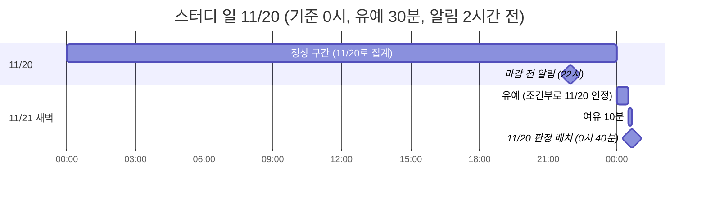
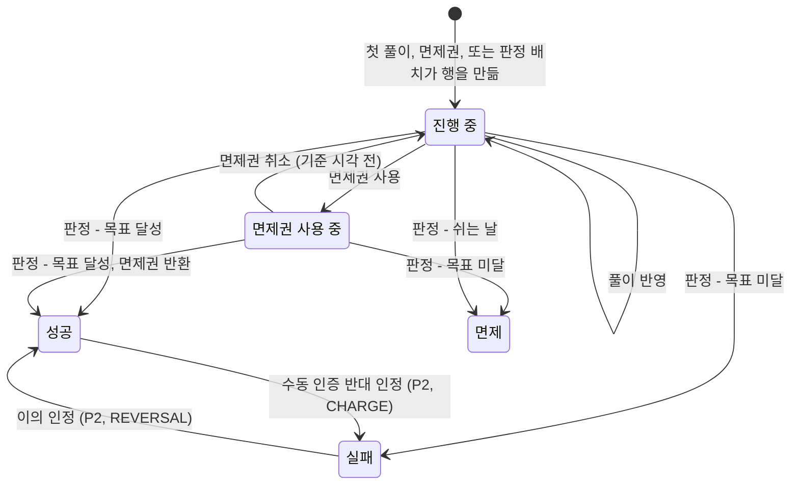
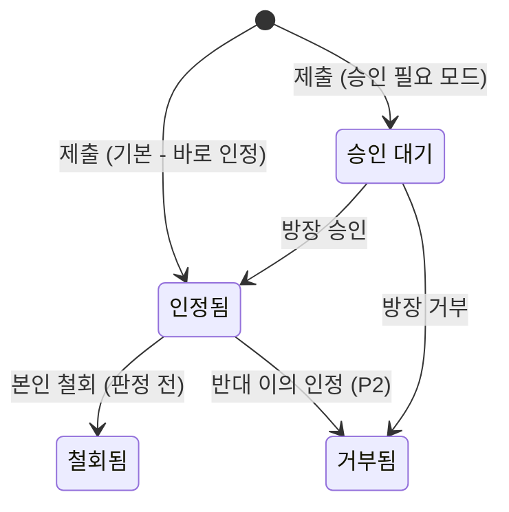
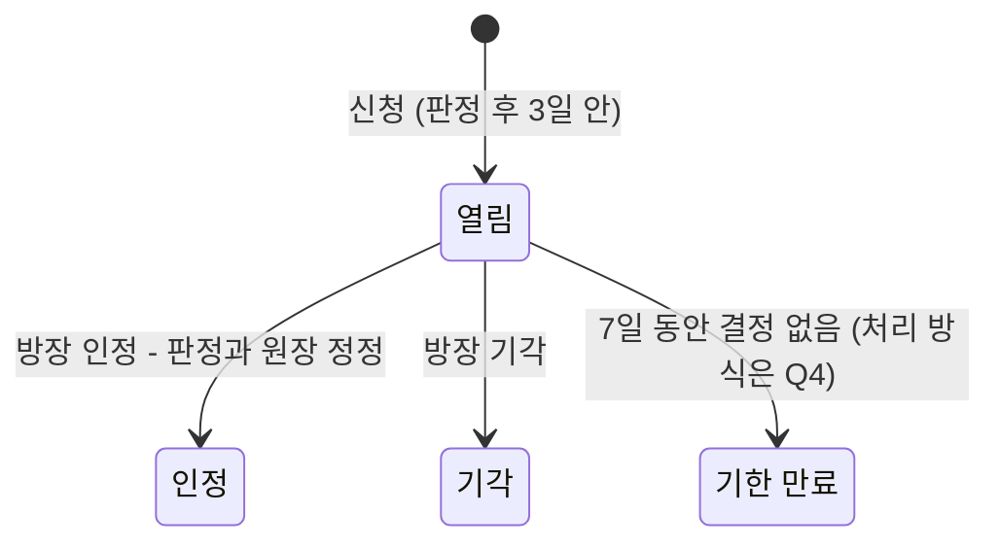
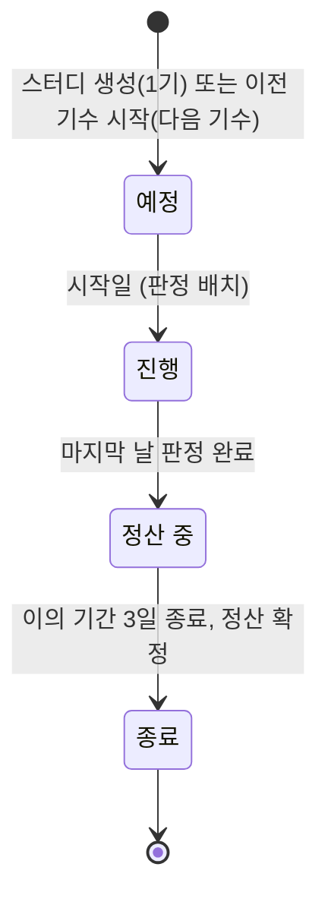

# 도메인 규칙

> 스펙 문서예요. 사람이 정한 내용만 담아요. 에이전트는 사람이 정한 결정을 `docs/` 브랜치의 문서 전용 PR로 반영하고, 그 밖에 바꿀 게 있으면 PR의 '스펙 변경 제안'에 적어요 (`docs/workflow.md` 4장).
>
> - P1은 아래 규칙(R1~R16)대로 구현해요. 3.6의 질문(Q)에 사람이 답하면 그 결정을 이 문서에 반영해요.
> - 규칙끼리 부딪히거나 빈 곳이 있으면 추측으로 채우지 말고 결정 제안서를 써요 (`docs/workflow.md` 3장).
> - 이미 알려진 빈 곳: 면제권 미리 쓰기(OD-09). `docs/decisions/README.md`를 보세요.
> - 코드에서 쓸 이름은 `docs/spec/glossary.md`에 있어요.

## 3.1 용어

| 용어                          | 뜻                                                                              |
|-------------------------------|---------------------------------------------------------------------------------|
| 스터디 (study)                | 같은 규칙으로 매일 인증하는 모임. 그룹 / 혼자 쓰기 두 모드                      |
| 기수 (season)                 | 스터디를 운영하는 4주 단위 구간. 정산과 요약의 단위                             |
| 방장 / 멤버                   | 스터디 운영자 / 참여자. 방장도 멤버로 판정받아요                                |
| 스터디 시간대                 | 판정 기준 시간대. 기본 `Asia/Seoul`                                             |
| 하루 기준 시각 (day boundary) | 스터디 일이 바뀌는 시각. 기본 00:00. 06:00으로 하면 새벽 5시 풀이는 전날로 집계 |
| 스터디 일 (study day)         | 판정 단위가 되는 하루. `[D 기준 시각, D+1 기준 시각)`                           |
| 유예 (grace)                  | 기준 시각 직후, 늦게 도착한 풀이를 전날로 인정할 수 있는 시간                   |
| 풀이 기록 (solve record)      | 누가 어떤 문제를 언제 풀었는지. GitHub, 수동 인증, 누락 복구로 생김             |
| 확인 대기                     | 커밋은 왔지만 어떤 문제인지 식별하지 못한 풀이                                  |
| 멤버 일 (member day)          | 멤버 × 스터디 일. 진행 상황(푼 수, 면제권)과 판정 결과를 담는 단위              |
| 판정                          | 멤버 일의 결과: 성공 / 실패 / 면제(쉬는 날 · 면제권)                            |
| 면제권                        | 기수마다 정해진 개수만큼 쓸 수 있는 '오늘 쉬기'                                 |
| 수동 인증 (self report)       | GitHub 없이 직접 신고한 풀이. 기본은 바로 인정                                  |
| 이의 (appeal)                 | 본인 판정 정정 요청, 또는 다른 사람의 수동 인증에 대한 반대                     |
| 원장 (ledger)                 | 벌금·정정·납부·보증금·환급을 순서대로 쌓는 기록. 수정·삭제하지 않음             |
| 정산                          | 주간·기수 단위로 원장을 요약한 표                                               |

## 3.2 규칙 (R)

- **R1. 규칙 항목**

  | 항목 | 범위 | 기본값 |
  |---|---|---|
  | 하루 목표 문제 수 | 1~5 | 1 |
  | 하루 기준 시각 | 00:00~06:00 | 00:00 |
  | 유예 | 0~120분 | 30분 |
  | 쉬는 요일 | 요일 선택 | 없음 |
  | 벌금 방식 | 없음 / 벌금 / 보증금 환급 | 없음 |
  | 벌금액 | 0~10,000원 | 1,000원 |
  | 기수당 면제권 | 0~10 | 4 |
  | 알림 시각 | 기준 시각 − N분 (30~360) | 120분 전 |
  | 수동 인증 방식 | 바로 인정 / 승인 필요 | 바로 인정 |
  | 기수 길이 | 7~56일 | 28일 |

- **R2. 규칙 변경은 다음 스터디 일부터, 일부 항목은 다음 기수부터 적용**해요. 과거 판정에는 소급하지 않아요. 규칙에 '적용 시작일 (effective_from)'을 두고 버전으로 관리하고, 바뀌면 멤버에게 알려요. (OD-08)
    - 다음 스터디 일부터: 하루 목표, 유예, 쉬는 요일, 알림 시각, 수동 인증 방식
    - 다음 기수부터: 하루 기준 시각, 기수 길이, 기수당 면제권, 벌금(방식·금액·보증금). 한 기수 안에서는 돈·면제권·끝 날짜가 한 규칙으로 고정돼요.
    - 하루 기준 시각이 바뀌는 기수 경계에서는 새 기수 첫날이 길이 차이를 떠안아요 (기준 시각 범위가 00:00~06:00이라 18~30시간). 지난 기수 마지막 날은 옛 규칙 그대로 끝나고, 새 기수 첫날은 그 끝에서 시작해 새 기준 시각에 끝나요.
- **R3. 풀이 인정 시각은 서버가 이벤트를 받은 시각**이에요 (D5). 수동 인증은 제출 시각이에요. 예외적으로 누락 복구 (5.14)로 찾은 풀이는 GitHub 활동 기록의 push 시각을 써요. 이 시각은
  커밋 작성자가 바꿀 수 없는 GitHub 쪽 기록이에요.
- **R4. 스터디 일 배정:** 수신 시각 t가 속한 스터디 일을 N이라고 해요. 다음 세 조건을 모두 만족하면 **전날 (N−1)**로 배정해요.
    - t가 N의 기준 시각부터 유예 안에 있다
    - N−1이 아직 판정 전이다
    - N−1이 판정 대상 (쉬는 날·면제권 아님)이고 목표 미달이다

  그 외에는 N으로 배정해요. (Q1에서 확인)
- **R5. 같은 문제는 같은 스터디 일에 한 번만** 세요. 다른 날 다시 푼 같은 문제를 인정할지는 Q2에서 정해요.
- **R6. 문제 식별** = (플랫폼, 문제 번호). 식별하지 못하면 '확인 대기'가 돼요. 멤버가 문제를 지정하면 **원래 수신 시각** 기준으로 반영해요. 그날이 이미 판정됐으면 이의로 처리해요.
- **R7. 수동 인증**
    - 입력: 스터디 일 (오늘, 또는 유예 중인 전날), 문제, 증거 링크 (선택), 메모
    - 기본은 '바로 인정'이라 즉시 집계돼요. 판정 전까지는 본인이 철회할 수 있어요.
    - 다른 멤버는 판정 후 3일까지 반대 (이의)할 수 있어요 (R11).
    - 방장이 '승인 필요'로 바꾸면 승인할 때 집계돼요.
    - 하루 5건까지만 받아요.
- **R8. 면제권:** 기수당 N개예요. 그 스터디 일의 기준 시각 전까지 사용·취소할 수 있어요. 면제권을 쓴 날 목표를 달성하면 판정에서 성공으로 처리하고 면제권을 돌려줘요.
- **R9. 판정**
    - 시점: D+1 기준 시각 + 유예 + 여유 10분 뒤에 배치가 판정해요.
    - 성공: 센 문제 수 ≥ 목표
    - 면제: 쉬는 요일, 면제권 사용 (미달성)
    - 실패: 그 외
    - 판정 대상: 가입한 다음 스터디 일부터, 탈퇴한 날까지, 기수 안의 날만. 1기 시작 전처럼 기수 밖인 날은 판정하지 않고 결과도 남기지 않아요 (OD-07)
- **R10. 원장**
    - 실패 → CHARGE (벌금 방식이 있을 때)
    - 판정 정정 → 반대 기록 (FAIL→SUCCESS는 REVERSAL, SUCCESS→FAIL은 CHARGE)
    - 기존 줄은 고치거나 지우지 않아요.
    - 납부 (PAYMENT)·보증금 (DEPOSIT)·환급 (REFUND)은 방장이 기록해요.
- **R11. 이의:** 판정 후 3일 안에 할 수 있어요. 결정은 방장이 해요. 방장 본인 관련 건과 방장이 결정하지 않는 건은 Q4에서 정해요.
    - (a) 본인 판정 정정 요청 (예: GitHub 전송이 늦었다)
    - (b) 다른 사람의 수동 인증에 대한 반대
- **R12. 잔액**
    - 벌금 방식: 낼 돈 = CHARGE − REVERSAL − PAYMENT
    - 보증금 방식: 돌려받을 돈 = DEPOSIT − (CHARGE − REVERSAL) − REFUND
    - 몰수된 금액 (회식비·기부·성공자 재분배) 처리는 Q9에서 정해요.
- **R13. 기수:** 시작일부터 기수 길이만큼 운영해요. 마지막 날 판정이 끝나면 정산 중이 되고, 이의 기간 (3일)이 지나면 정산이 확정돼요. 다음 기수는 같은 규칙(다음 기수부터 적용하기로 한 변경 포함, R2)으로 자동 생성되고 마지막 날 다음 날 바로 시작해요 (P1, OD-07). 그래서 이전 기수가 정산 중인 동안 다음 기수가 진행돼요. 다음 기수 행은 이번 기수가 시작될 때 예정으로 만들어 둬요. 새 기수 첫날이 시작되는 순간부터 기수 안이어야 하기 때문이에요 (5.13). P3부터는
  '이어가기 확인'을 받아요.
- **R14. 가입·탈퇴:** 가입하면 다음 스터디 일부터 판정해요. 탈퇴하면 그날까지 판정하고, 원장은 보존해요. 방장은 위임한 뒤에만 탈퇴할 수 있어요.
- **R15. 혼자 쓰기:** 멤버가 1명인 스터디예요. 초대·공유·이의가 없고, 벌금 방식 기본값은 '없음'이에요.
- **R16. 개인정보:** 웹훅 원본은 14일 뒤 삭제해요. 풀이 기록에는 필요한 필드만 저장해요 (9.8).

## 3.3 시간 규칙 한눈에 보기

기준 시각 00:00, 유예 30분, 알림 120분 전인 스터디의 11/20 예시예요.

## 3.4 상태 다이어그램

**멤버 일**

**수동 인증**

**이의 (P2)**

**기수**

## 3.5 판정 예시

목표 1문제, 기준 00:00, 유예 30분, 벌금 1,000원일 때예요.

| 상황                                                  | 결과                                                                                                                         |
|-------------------------------------------------------|------------------------------------------------------------------------------------------------------------------------------|
| 11/20 23:50 수신                                      | 11/20 성공                                                                                                                   |
| 11/21 00:20 수신, 11/20 목표 미달                     | 11/20으로 배정 → 11/20 성공 (유예)                                                                                           |
| 11/21 00:20 수신, 11/20 이미 달성                     | 11/21 풀이로 집계                                                                                                            |
| 11/21 00:35 수신, 11/20 목표 미달                     | 유예 밖 → 11/21 풀이. 11/20은 실패 (+1,000원)                                                                                |
| 11/20 면제권 사용 후 23:00 풀이                       | 11/20 성공, 면제권 반환                                                                                                      |
| 11/20 면제권 사용, 풀이 없음                          | 11/20 면제                                                                                                                   |
| 같은 날 같은 문제를 두 번 커밋                        | 1문제로 셈                                                                                                                   |
| 23:59에 푸시했는데 GitHub 전송이 00:45에 도착         | 11/21로 집계, 11/20 실패 → 이의 → 방장 인정 → 11/20 성공으로 정정 + REVERSAL. P2부터는 복구 작업이 push 시각을 근거로 보여줌 |
| 기준 06:00 스터디에서 새벽 03:00 풀이                 | 전날로 집계                                                                                                                  |
| 11/20에 가입                                          | 11/21부터 판정                                                                                                               |
| 수동 인증으로 11/20 성공 → 다른 멤버 반대 → 방장 인정 | 11/20 실패로 정정 + CHARGE                                                                                                   |

## 3.6 열린 질문 (Q)

인터뷰와 본인 스터디 운영으로 답을 찾아요.

- **Q1.** 유예 기본값 (30분)과 전날 배정 방식 (R4)이 실제 관행과 맞나?
- **Q2.** 이전에 푼 문제를 다시 푸는 복습도 인정하나?
- **Q3.** 난이도 조건 (예: 실버 이상)이 필요한가? MVP에서는 빼는 걸 추천
- **Q4.** 방장 본인 관련 이의는 누가 결정하나? 방장이 7일 동안 결정하지 않은 이의는? (부방장 / 멤버 과반 / 자동 기각)
- **Q5.** 벌금 상한이나 연속 실패 시 강퇴 규칙이 필요한가?
- **Q6.** 공휴일은 어떻게 처리하나?
- **Q7.** 스터디 소통 채널 비율은? (카톡 / 디스코드) → 디스코드 기능 우선순위
- **Q8.** 풀이를 GitHub에 올리지 않는 멤버 비율은? → 수동 인증 UX 우선순위
- **Q9.** 보증금 방식에서 몰수된 금액은 어떻게 쓰나? (회식비 / 기부 / 성공자 재분배)
- **Q10.** 멤버 중 iPhone 비율은? → 웹 푸시 도달률 예상
- **Q11.** 기수 길이 4주가 맞나?
- **Q12.** 알림은 언제, 몇 번이 좋은가? (기본: 마감 2시간 전 1번)
