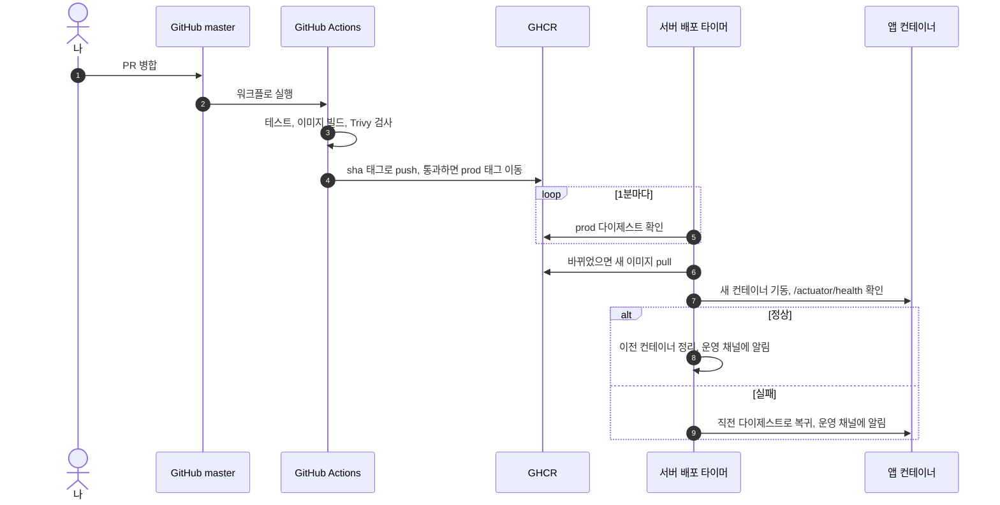
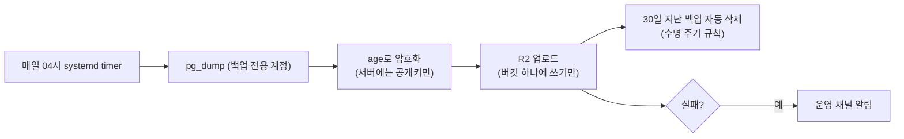

# 인프라·배포·운영 보안

> 스펙 문서예요. 사람이 정한 내용만 담아요. 에이전트는 사람이 정한 결정을 `docs/` 브랜치의 문서 전용 PR로 반영하고, 그 밖에 바꿀 게 있으면 PR의 '스펙 변경 제안'에 적어요 (`docs/workflow.md` 4장).
>
> - 이 문서의 대부분은 사람이 적용해요 (계정, 서버, 비밀값, Cloudflare·Supabase 설정).
> - 에이전트는 S17에서 레포에 들어가는 산출물(Dockerfile, Compose, 워크플로, 배포·백업 스크립트, 런북)만 만들어요. 실제 서버·계정·비밀값에는 접근하지 않아요.
> - 9.10 '운영 시작 전 점검표'는 P1이 끝날 때 사람이 확인해요.

## 9.1 확정 구성

구성도는 4.1에 있어요.

| 구성 요소     | 선택                                      | 핵심 이유                                              |
|---------------|-------------------------------------------|--------------------------------------------------------|
| 앞단          | Cloudflare 무료 + Tunnel                  | 서버에 80/443 포트를 열지 않음. DDoS 완화 무제한 [S51] |
| 서버          | Lightsail 서울 General purpose 2GB (IPv4) | 월 $12 고정, 데이터 전송 허용량 3TB [S47]              |
| DB            | Supabase 무료, 서울                       | 초과 사용에 과금 없음 [S44]                            |
| 이미지 저장소 | GitHub Container Registry(GHCR)           | 컨테이너 이미지 저장·전송 현재 무료 [S54]              |
| 배포          | 풀 방식 (9.2)                             | CI에 서버 접속 정보·AWS 키를 두지 않음                 |
| 백업          | 서버에서 암호화 후 Cloudflare R2          | R2 무료 10GB, 내려받기 요금 없음 [S53]                 |
| 알림          | 웹 푸시, 카카오톡 공유, 디스코드 웹훅     | 모두 무료                                              |

**제외한 후보와 이유:** Render 무료 (15분 무활동 시 정지 [S59]), Oracle 무료 (인스턴스 받기 어려움, 회수 위험 [S60]), Fly.io (신규 무료 플랜 없음), AWS 무료 플랜
(6개월 뒤 계정 종료).

## 9.2 배포 방식

**요구 조건:** ① CI에 서버 접속 정보나 AWS 키를 두지 않는다 ② 열린 인바운드 포트를 최소로 ③ 배포 실패 시 자동 롤백 ④ 혼자 운영할 만큼 단순하게

| 방식                                                    | 열어야 하는 포트                                          | CI가 가진 비밀                         | 판단                                                                    |
|---------------------------------------------------------|-----------------------------------------------------------|----------------------------------------|-------------------------------------------------------------------------|
| A. Actions에서 SSH로 접속해 배포                        | 22번을 GitHub 러너 IP에 열어야 함 (대역이 넓고 자주 바뀜) | 서버 SSH 키                            | 제외                                                                    |
| B. 서버에 셀프 호스티드 러너 설치                       | 없음                                                      | —                                      | **제외.** 공개 레포에서는 포크 PR로 서버에서 임의 코드가 실행될 수 있음 |
| C. Lightsail 컨테이너 서비스                            | 없음                                                      | AWS 키                                 | 제외. 같은 돈이면 인스턴스 2GB가 나음                                   |
| D. Watchtower 같은 자동 업데이트 도구                   | 없음                                                      | —                                      | 제외. 원본은 2025년 12월 보관 처리됨 [S58]. `docker.sock`을 넘겨야 함   |
| **E. 풀 방식: CI는 이미지만 올리고 서버가 가져와 교체** | 없음 (SSH만 내 IP)                                        | 레지스트리 쓰기 권한(`GITHUB_TOKEN`)뿐 | **채택**                                                                |

- **수동 롤백:** GHCR에서 이전 이미지에 `prod` 태그를 다시 붙이면 1분 안에 되돌아가요.
- **배포 중 웹훅:** 컨테이너를 바꾸는 수십 초 동안 들어온 웹훅은 실패할 수 있어요. P2 복구 작업 (5.14)이 메워요. 세션은 DB에 있어서 로그아웃되지 않아요 (D22).
- (P4, 선택) Nginx 업스트림 전환으로 무중단 (블루-그린) 배포.

**CI 보안 체크리스트**

- 워크플로 권한 최소화 (`permissions: contents: read`, 이미지 푸시 잡만 `packages: write`)
- 서드파티 액션은 버전 태그가 아니라 커밋 SHA로 고정
- `pull_request_target` 쓰지 않기. 포크 PR에서는 시크릿 없이 테스트만
- `master`는 PR로만 병합하고 CI 통과를 필수 조건으로

## 9.3 월 비용

| 항목                             | 월 비용                | 조건과 주의점                                                      |
|----------------------------------|------------------------|--------------------------------------------------------------------|
| Lightsail 2GB (IPv4)             | $12                    | 데이터 전송 허용량 3TB 포함 [S47]                                  |
| 고정 IP                          | $0                     | 인스턴스에 붙어 있을 때만 무료. 떼어 두면 시간당 과금 [S49]        |
| 스냅샷                           | $0 (쓰지 않음)         | 서버는 레포의 설정으로 다시 만들 수 있으니 DB만 백업               |
| Supabase                         | $0                     | 초과 시 과금 대신 서비스 제한 [S44]                                |
| Cloudflare 프록시·Tunnel·Access  | $0                     | Access는 50명까지 무료                                             |
| Cloudflare R2 (백업)             | $0                     | 무료: 저장 10GB-월, 내려받기 요금 없음 [S53]                       |
| GHCR                             | $0                     | 컨테이너 이미지 현재 무료 [S54]                                    |
| GitHub Actions                   | $0                     | 공개 레포 무료                                                     |
| 웹 푸시, 카카오톡 공유, 디스코드 | $0                     | 브라우저 제조사의 푸시 서비스, 카카오 SDK, 디스코드 웹훅 모두 무료 |
| 도메인                           | 연 단위 결제           | 종류에 따라 다름                                                   |
| **합계**                         | **월 약 $12 + 도메인** | **상한 월 $15**                                                    |

- **더 아끼고 싶다면:** 1GB 번들 (월 $7)로 시작할 수 있어요. JVM 힙을 제한 (예: `-Xmx384m`)하고 스왑을 잡아야 해요. 메모리 지표를 보다가 부족하면 2GB로 옮겨요.
- IPv6 전용 번들은 쓰지 않아요. 고정 IPv4가 없어 Supabase IP 제한 (9.4)을 걸 수 없어요.

## 9.4 Supabase 사용 규칙

- 리전: 서울 (서버와 같은 지역)
- 연결: Session pooler (IPv4, 5432). Transaction mode (6543)는 prepared statement를 지원하지 않아서 쓰지 않음 [S43]
- SSL 강제 + 앱은 `sslmode=verify-full`로 인증서까지 검증 [S46]
- Network Restrictions: Lightsail 고정 IP만 허용 [S45]. 내 PC에서 볼 일이 있으면 잠깐 추가했다가 지우기
- Data API 끄기 + 앱 테이블은 `public`이 아닌 별도 스키마 `studybot` (OD-06, 결정 제안서 004)
- DB 역할 분리: 마이그레이션용 (소유자) / 앱 실행용 (조회·쓰기) / 백업용 (읽기). 원장 테이블은 앱 역할에서 UPDATE·DELETE 회수
- 커넥션 풀은 작게 (최대 5~10). 세션 테이블 (D22)도 같은 DB라 요청마다 조회가 생기니 실제 사용량을 확인
- 1주일 비활성 시 일시정지 [S42] → 판정 배치가 매일 돌면 해당 없음. 서버가 오래 죽으면 DB도 멈출 수 있으니 헬스체크 알림 필수
- 모든 목록 API 페이지네이션 (egress 5GB 보호)
- Supabase 계정 2단계 인증

## 9.5 비용 폭탄 방어

**실제로 요금이 터지는 순서 (위험도 순)**

| 순위 | 위험                      | 어떻게 일어나나                                                                   | 막는 법                                                                                                            |
|------|---------------------------|-----------------------------------------------------------------------------------|--------------------------------------------------------------------------------------------------------------------|
| 1    | 키·비밀 유출              | 공개 레포에 클라우드 키가 올라가면 남이 리소스를 만들어 요금을 발생시킴           | **AWS 액세스 키를 아예 만들지 않음** (D16). 모든 계정 2단계 인증. 공개 레포는 푸시 보호가 기본으로 켜져 있음 [S56] |
| 2    | Lightsail 아웃바운드 초과 | 허용량 3TB(인+아웃 합산)를 넘기면 아웃바운드에만 서울 GB당 $0.13, 상한 없음 [S48] | Cloudflare 캐시, 큰 응답 금지, 지표 알림                                                                           |
| 3    | 잊힌 유료 리소스          | 떼어 둔 고정 IP, 쌓인 스냅샷, 지우지 않은 인스턴스                                | 월 1회 청구서 확인, 예산 알림                                                                                      |
| 4    | DDoS·봇                   | 서버가 느려지거나 멈춤 (컴퓨트는 고정 요금이라 비용은 그대로)                     | Cloudflare + Tunnel로 서버 IP 비공개, 요청 수 제한                                                                 |
| 5    | Supabase 할당량 초과      | 과금은 없고 서비스가 제한됨 = 장애                                                | 페이지네이션, 요청 수 제한, 사용량 메일 확인                                                                       |

- **최악의 경우:** 아웃바운드가 허용량을 1TB 넘기면 1,000GB × $0.13 = 약 $130이에요.
- Tunnel을 거쳐도 서버에서 Cloudflare로 나가는 트래픽은 Lightsail 아웃바운드로 계산돼요. 정적 파일은 Cloudflare 캐시에서 응답하게 해요.

**Cloudflare 설정**

- **Bot Fight Mode 끄기.** 경로별 예외를 둘 수 없어서 GitHub·디스코드 웹훅까지 막을 수 있음 [S52]
- 요청 수 제한 규칙 (무료 1개)은 `/api/*`에만 적용하고 `/webhooks/*`는 제외 [S51]
- 정적 파일 캐시 (`sw.js`와 `index.html`은 제외), 'Always Use HTTPS', HSTS
- 공격받을 때 쓸 'Under Attack' 모드 위치 미리 확인
- `/admin/*`은 Cloudflare Access로 보호

**알림 (실시간이 아니라 몇 시간 늦을 수 있으니 겹쳐 두기)**

- AWS 예산 알림: 월 $15
- Lightsail 지표 알림: 아웃바운드 전송량이 평소보다 크게 늘면
- Supabase 사용량 경고 메일
- 외부 헬스체크, 백업·배포 결과 → 운영용 디스코드 채널

## 9.6 보안: 계정·서버·컨테이너·비밀·백업

**계정**

- AWS 루트 계정 2단계 인증, 액세스 키는 만들지 않기
- GitHub, Cloudflare, Supabase, 카카오 디벨로퍼스, 디스코드 개발자 계정 2단계 인증

**서버 (OS)**

- Ubuntu LTS, 보안 업데이트 자동 설치 (`unattended-upgrades`)
- SSH는 키 인증만, 비밀번호 로그인과 root 로그인 끄기
- Lightsail 방화벽: 22번만, 내 IP와 Lightsail 브라우저 SSH만 허용 [S50]. **80/443은 열지 않음** (Tunnel). IPv6 방화벽도 따로 확인
- 스왑 설정

**컨테이너**

- 앱 컨테이너는 root가 아닌 사용자로 실행
- 메모리 제한 (JVM 힙 + 여유분), JVM이 컨테이너 메모리를 인식하게
- `docker.sock`은 어떤 컨테이너에도 마운트하지 않기
- Nginx와 Spring은 호스트 포트를 공개하지 않고 내부 Docker 네트워크로만 연결
- 이미지는 다이제스트로 고정, CI에서 Trivy로 취약점 검사

**비밀 관리**

| 비밀                                    | 보관 위치                              | 유출이 의심되면                                                         |
|-----------------------------------------|----------------------------------------|-------------------------------------------------------------------------|
| DB 비밀번호 (앱·마이그레이션·백업 계정) | 서버 `.env` (권한 600)                 | Supabase에서 변경                                                       |
| GitHub App private key (운영)           | 서버 파일 (권한 400, 읽기 전용 마운트) | 새 키 발급 후 기존 키 삭제                                              |
| GitHub 웹훅 시크릿                      | `.env`                                 | App 설정에서 교체. 교체하는 동안은 옛 값과 새 값을 모두 받아들이게 구현 |
| GitHub App client secret (로그인)       | `.env`                                 | 재발급                                                                  |
| VAPID 개인키                            | `.env`                                 | 교체하면 모든 푸시 구독이 무효 → 재구독 안내 (5.8)                      |
| 디스코드 웹훅 URL 암호화 키             | `.env`                                 | 키 교체 후 저장된 URL 재암호화                                          |
| (P3) 디스코드 봇 토큰                   | `.env`                                 | 재발급                                                                  |
| Cloudflare Tunnel 토큰                  | `.env`                                 | 교체                                                                    |
| R2 키 (백업 버킷 하나에 쓰기만)         | `.env`                                 | 폐기 후 재발급                                                          |
| 백업 암호화 키                          | 공개키만 서버에, 개인키는 오프라인     | —                                                                       |
| 카카오 JavaScript 키                    | 프론트 (공개 값)                       | 등록 도메인 제한 확인                                                   |

- 레포, 이미지, 로그에는 비밀을 넣지 않아요. 푸시 보호는 탐지 형식이 한정적이라 보조 수단일 뿐이에요.
- 비밀이 레포에 한 번이라도 올라갔다면 커밋을 지우는 게 아니라 **비밀 자체를 교체**해요.
- 교체 절차는 `docs/ops/runbooks/secret-rotation.md`에 적어 두고 한 번 연습해요.

**백업**

- 분기 1회 복구 연습 (로컬 PostgreSQL에 복원)
- **공개 레포의 Actions 아티팩트에 백업을 두지 않기.** 읽기 권한이 있으면 누구나 내려받을 수 있음 [S55]

## 9.9 모니터링

- Actuator + Micrometer 지표 (외부 노출은 `health`만)
- 커스텀 지표: 웹훅 처리 지연, inbox 대기·실패·DEAD 건수, 식별 실패율, 판정 배치 소요 시간, 알림 발송 성공률, 커넥션 풀 사용량
- **운영용 디스코드 채널 (나만 보는 곳)로 알림:** 배포·백업 결과, inbox DEAD 발생, 판정 배치 실패·지연, 알림 실패율 급증, 식별 실패율 급증, 외부 헬스체크 실패

## 9.10 운영 시작 전 점검표 (P1 끝)

- 외부에서 포트 스캔: 22번 (내 IP 한정) 말고 열린 포트 없음
- `/actuator/env`, `/actuator/heapdump` 접근 불가
- 다른 계정으로 로그인해 남의 스터디 API 호출 → 거부됨 (T19)
- 서명이 틀린 웹훅 → 거절 / 같은 delivery 두 번 → 한 번만 처리 (T1, T2)
- Setup URL에 남의 installation_id를 넣어도 연결 안 됨 (T21)
- 디스코드 웹훅 URL과 푸시 구독 주소 검증 (T27, T28)
- 레포 전체 비밀 검사 (gitleaks 등) 통과
- Supabase: Data API 꺼짐, SSL 강제, IP 제한 확인
- Cloudflare: Bot Fight Mode 꺼짐, 웹훅 경로 정상 수신, `/admin` Access 적용
- 배포 후에도 로그인 유지 (D22), 롤백 1회 연습
- 백업 복구 연습 1회 성공
- 예산 알림, 헬스체크, 백업 실패 알림 실제 수신 확인
- iPhone (홈 화면 추가)과 Android에서 웹 푸시 수신 확인
- 카카오톡 공유로 단톡방·오픈채팅방 전송 확인
- 개인정보처리방침 게시
