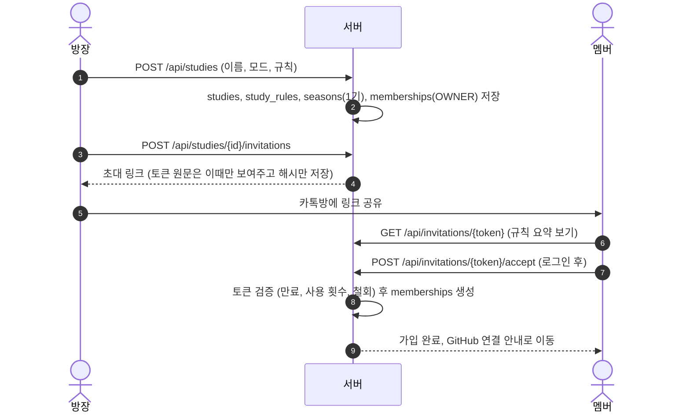

# 5.1 스터디 개설과 초대 (P1)

**목적:** 방장이 1분 안에 스터디를 만들고, 멤버는 링크 하나로 들어오게 한다.

**처리 순서**

1. 스터디를 만들면 규칙 1번 버전 (effective_from = 시작일), 1기 기수, 방장 멤버십을 한 트랜잭션으로 저장해요.
2. 초대 토큰은 32바이트 무작위 값 (base64url)으로 만들고, DB에는 SHA-256 해시만 저장해요.
3. 수락하면 `judged_from = 가입 다음 스터디 일`로 멤버십을 만들어요 (R14).

**만들 것**

- 규칙 마법사 기본값 (R1 표)
- 초대 토큰 생성·해시 저장·만료 (기본 7일)·철회
- 수락 API: 같은 사람이 두 번 눌러도 결과가 같게 (이미 멤버면 그대로 성공)
- 정원 제한 (MVP는 30명)
- 혼자 쓰기 모드: 초대 기능 숨김

**주의할 것**

- **정원 동시성:** 두 명이 동시에 마지막 자리를 수락하면 정원이 넘칠 수 있어요.
  `UPDATE invitations SET used_count = used_count + 1 WHERE id = ? AND used_count < max_uses`의 영향받은 행 수로 판단해요.
- **토큰 원문은 저장하지 않아요.** DB가 유출돼도 초대 링크를 만들 수 없게요.
- 스터디 시간대는 만들 때 정하고 바꾸지 않는 게 안전해요. 바꿔야 하면 새 기수부터 적용해요.
- 가입 전에 규칙을 보여줘야 나중에 "그런 규칙인 줄 몰랐다"는 분쟁이 줄어요.

**테스트:** T19, T20
