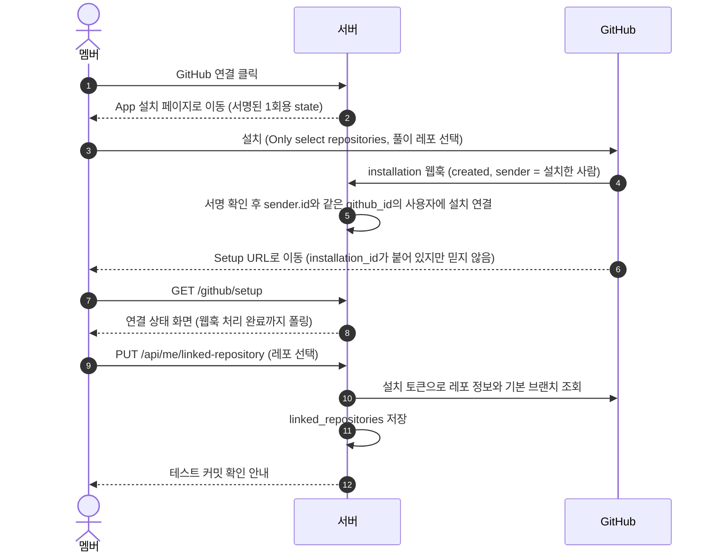

# 5.2 GitHub 연결 (P1)

**목적:** 멤버의 풀이 레포를 안전하게 이 서비스와 연결한다.

**처리 순서**

1. `installation` 웹훅 (created)이 오면 `installation.account.type == User`이고 `account.id == sender.id`인지 확인해요. 그 `id`와
   `github_id`가 같은 사용자에게 설치를 연결해요.
2. 아직 가입하지 않은 사람이 먼저 설치했다면 설치만 저장해 두고, 가입할 때 `github_id`로 연결해요.
3. 레포를 하나만 골랐으면 자동으로 연결하고, 여러 개면 사용자가 고르게 해요.
4. `installation_repositories`(removed), `installation`(deleted, suspend) 이벤트가 오면 연결을 비활성화하고 사용자에게 알려요. 그동안은 수동 인증으로
   안내해요.

**만들 것**

- 설치 이벤트 처리: created, deleted, suspend, unsuspend
- 레포 이벤트 처리: added, removed
- App JWT (최대 10분 유효) 생성, 설치 토큰 (1시간 유효) 발급과 만료 전 갱신 캐시
- 연결 화면: 단계 안내 (백준허브 설치 → 레포 → App 설치), 현재 상태, 테스트 커밋 확인

**주의할 것**

- **Setup URL의 `installation_id`는 위조될 수 있어요** [S37]. 이 값으로 설치를 연결하면 남의 설치를 내 것으로 가져갈 수 있어요. 연결은 서명된 웹훅의 설치자 정보로만 해요. 설치자
  확인용 사용자 토큰을 따로 받는 방법도 있어요 (결정 제안서 005).
- **조직 (Organization) 레포는 조직 관리자 승인이 필요해요.** 개인 레포를 쓰도록 안내해요.
- 레포 이름은 바뀔 수 있으니 `repo_id`로 추적해요.
- MVP는 사용자당 레포 1개만 연결해요. 여러 개는 수요가 확인되면 해요.

**테스트:** T21
