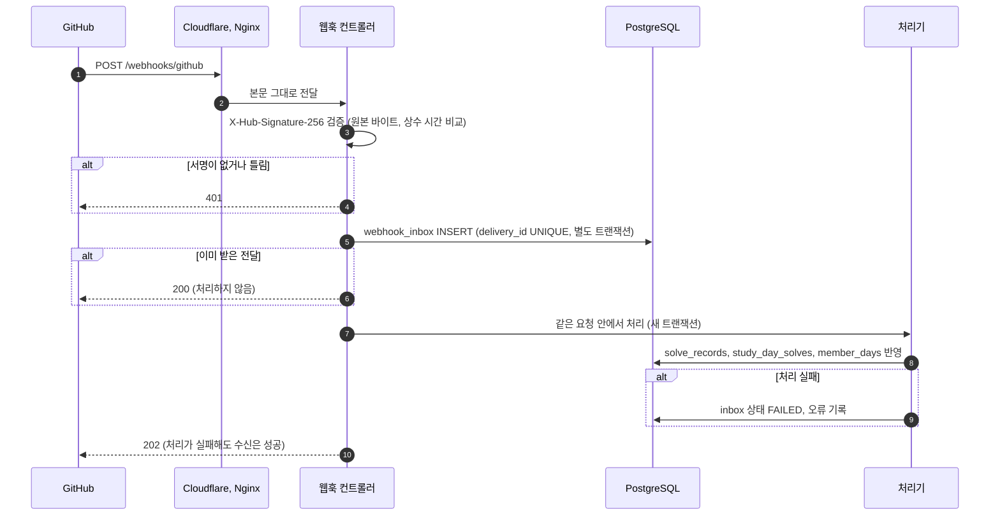
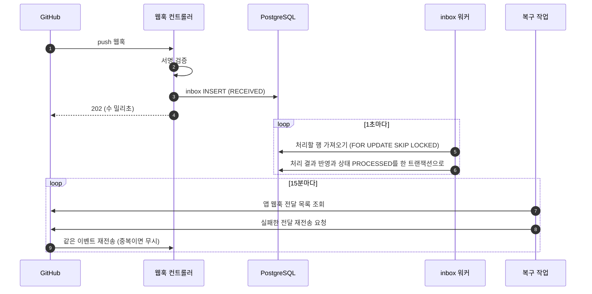
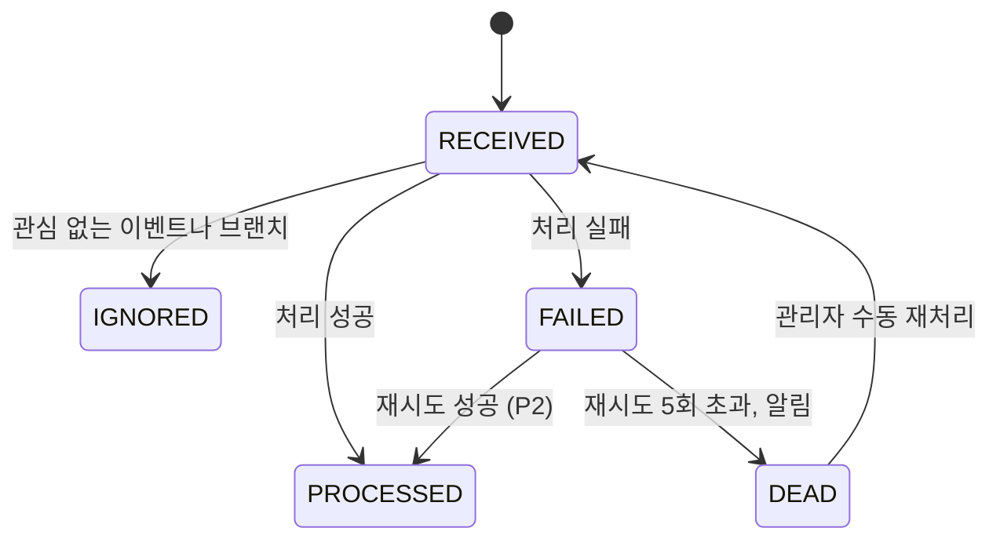

# 5.3 자동 인증: push 웹훅 처리 (P1 → P2)

**목적:** 커밋이 올라오면 놓치지 않고, 한 번만 인정한다.

**P1: 수신 기록 후 같은 요청에서 처리**

**P2: inbox + 비동기 워커 + 누락 복구**

**응답 코드 규칙**

| 상황                        | 응답      | 이유                                           |
|-----------------------------|-----------|------------------------------------------------|
| 서명이 없거나 틀림          | 401       | 위조 차단                                      |
| `ping`이나 관심 없는 이벤트 | 200 / 204 | GitHub에 실패로 남지 않게                      |
| 이미 받은 전달              | 200       | 중복 무시                                      |
| 저장 성공                   | 202       | 처리는 별개                                    |
| DB 장애로 저장 실패         | 503       | GitHub에 실패로 남아야 나중에 재전송할 수 있음 |

**push 처리 순서**

1. `deleted == true`이거나 `ref`가 기본 브랜치가 아니면 IGNORED
2. `repository.id`로 활성 연결 레포를 찾아요. 없으면 IGNORED (설치는 했지만 고르지 않은 레포)
3. `commits[]`의 커밋마다 추가·수정된 파일 경로와 메시지를 파서에 넣어요 (5.4)
4. 문제마다 `solve_records`를 INSERT하고, 이미 있으면 무시해요
5. 사용자가 속한 활성 스터디마다 스터디 일을 배정하고 (5.5), `study_day_solves` INSERT (중복 무시), `member_days.solved_count` 갱신
6. **인정 시각 = `webhook_inbox.received_at`**이에요. 워커가 처리한 시각이 아니에요.

**만들 것**

- P1: 서명 검증 필터, inbox 저장, 같은 요청 안 처리, 실패 기록, 관리자 재처리 명령
- P2: 워커 (SKIP LOCKED, 지수 백오프 재시도, 5회 초과 시 DEAD + 알림), 복구 작업 (5.14)
- 처리 지연 (수신 → 반영) p95, 실패·DEAD 건수 지표

**주의할 것**

- **원본 바이트로 검증해요.** Spring에서 본문을 `byte[]`로 받아 서명부터 확인하고, 그 다음에 JSON으로 파싱해요. 객체로 먼저 받으면 직렬화가 달라져 서명이 안 맞아요 [S36].
- 비교는 `MessageDigest.isEqual`로 상수 시간 비교해요 [S36].
- **10초 안에 응답해야 해요** [S33]. P1에서도 처리 안에서 GitHub API를 부르지 않아요.
- **GitHub는 실패한 전달을 자동으로 다시 보내지 않아요** [S34]. 재전송은 3일 안의 전달만 가능해요 [S35]. 그래서 P2 복구 작업을 15분마다 돌려요.
- Cloudflare나 Nginx가 본문을 바꾸면 서명이 깨져요. Bot Fight Mode는 끄고 (9.5), 웹훅 경로에는 어떤 변환 규칙도 걸지 않아요.
- `commits` 목록은 잘릴 수 있어요 (공식 스키마상 최대 2,048개) [S39]. 백준허브는 문제당 커밋 하나라 드물지만, 목록이 비었는데 `before`와 `after`가 다르면 compare API로
  보완해요 (P2).
- force push로 같은 문제가 새 SHA로 다시 와도 R5 유니크 제약이 같은 날 중복을 막아요.
- payload에는 커밋 작성자 이메일이 들어 있어요. 원본은 14일 뒤 삭제해요 (R16).
- 본문 크기 제한을 걸어요 (Nginx `client_max_body_size`, 예: 5MB).

**테스트:** T1, T2, T3, T4, T5
