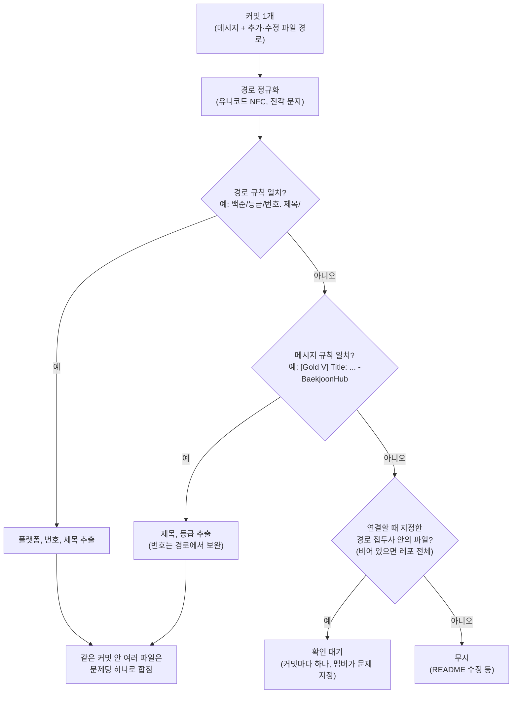

# 5.4 문제 식별 (P1)

**목적:** 커밋을 보고 어떤 플랫폼의 몇 번 문제인지 알아낸다.

**확인 대기 (S08)**

- 경로 접두사가 비어 있으면 레포 전체가 범위예요. 접두사는 경로 조각(폴더) 단위로 비교해요 (data-model 'GitHub 연결 테이블'의 `linked_repositories`).
- 확인 대기는 커밋마다 하나예요. 문제를 하나도 식별하지 못한 커밋에서, 식별하지 못한 풀이 파일 중 접두사 안의 첫 파일을 원본 경로로 남겨요. 문제를 식별한 커밋에 남은 파일은 확인 대기로 남기지 않아요.
- P1에는 멤버가 접두사를 정하는 설정이 없어요. 그래서 모든 연결이 레포 전체를 봐요. 확인 대기가 너무 많이 쌓이면 다시 정해요.

**알려진 형식 (예시이며 실제 샘플로 확정: 사람 할 일 H-01) [S41]**

| 도구·플랫폼                 | 커밋 메시지 예                                                            | 경로 예                                         |
|-----------------------------|---------------------------------------------------------------------------|-------------------------------------------------|
| 백준허브 · 백준             | `[Gold V] Title: 문제 제목, Time: 0 ms, Memory: 14164 KB -BaekjoonHub`    | `백준/Gold/1234. 문제 제목/풀이.java`           |
| 백준허브 · 프로그래머스     | `[level 1] Title: 문제 제목, Time: 0.03 ms, Memory: 77.8 MB -BaekjoonHub` | `프로그래머스/1/12916. 문제 제목/solution.java` |
| LeetCode 확장(LeetHub 계열) | 버전마다 다름                                                             | `0001-two-sum/two-sum.java` 형태                |
| 코드트리 GitHub 연동        | 확인 필요                                                                 | 확인 필요                                       |

**만들 것**

- 파서는 DB를 모르는 순수 함수로 만들어요: `parse(commitMessage, paths) → List<ProblemRef>`
- 실제 커밋 샘플을 `src/test/resources/commit-samples/`에 모아 테스트로 고정
- 파서 버전을 풀이 기록에 남겨 두고, 파서를 고치면 '확인 대기'를 다시 분석하는 관리자 명령
- 식별 실패율 지표 (확인 대기 ÷ GitHub 풀이)

**주의할 것**

- 백준허브 경로에는 전각 문자 (＋, ［ ］)가 섞여 있어요. 제목 비교에 쓰지 말고 번호로만 식별해요.
- macOS에서 직접 커밋하면 한글 경로가 NFD로 올 수 있어요. 비교 전에 NFC로 정규화해요.
- 백준과 프로그래머스의 문제 번호는 겹칠 수 있어요. 키는 항상 (플랫폼, 번호)예요.
- **재개된 백준에서 백준허브 형식이 바뀔 수 있어요.** 식별 실패율이 갑자기 오르면 형식 변경을 의심하고 샘플을 다시 모아요.

**테스트:** T26 (확인 대기 지정), 샘플 기반 파서 테스트
