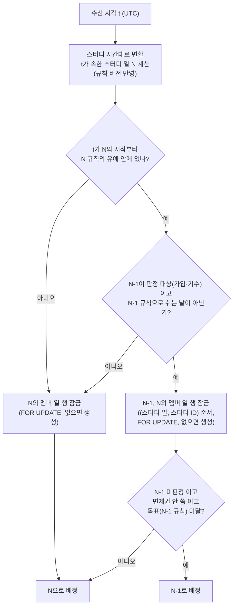

# 5.5 스터디 일 배정 (P1)

**목적:** 풀이를 어느 날의 것으로 셀지 규칙 (R4)대로 정확히 정한다.

사용자가 속한 스터디(배정할 때 탈퇴하지 않은 멤버십, R14)마다 정해요. 스터디가 여럿이면 모든 스터디의 잠글 행을 먼저 모아 순서대로 잠근 뒤, 스터디마다 배정할 날을 정해요 (아래 '잠금 순서', 결정 제안서 007).

**만들 것**

- 시간 계산은 `common.time` 한 곳에: 규칙 하나는 `StudyCalendar`, 규칙 버전에 걸친 계산은 `RuleVersionCalendar`
  (`studyDayOf(t)`, `startOf(day)`, `isInGrace(t)`, `judgeAt(day)`. 알림 시각 `reminderAt(day)`은 S13)
- 배정 함수: 규칙은 **그날의 규칙 버전**을 써요 (전날 목표는 전날 규칙으로)
- `member_days` 행 upsert: `INSERT ... ON CONFLICT DO NOTHING` 후 `SELECT ... FOR UPDATE`
- 배정 대상: 배정할 때 사용자가 탈퇴하지 않은 멤버십의 스터디만이에요. 그래서 탈퇴한 뒤 다시 가입하기 전까지는 탈퇴한 날을 포함해 어느 날에도 세지 않아요 (R14)

**주의할 것**

- **동시성:** 목표 1문제인 멤버의 push 두 개가 00:05에 동시에 오면, 둘 다 전날로 가서 오늘이 0이 될 수 있어요. 전날 멤버 일 행을 잠그고 그 안에서 확인하면 첫 번째만 전날로 가요.
- **잠금 순서:** 풀이 하나마다 잠글 행(후보 전날, 오늘)을 모든 스터디에 걸쳐 모아 (스터디 일, 스터디 ID) 순서로 잠근 뒤 배정할 날을 정해요. 전날로 배정해도 오늘 행을 잠가요. 잠그는 행이 배정 결과에 따라 달라지면 스터디가 여럿일 때 순서가 섞여 교착 상태가 나요. 한 트랜잭션에서 여러 풀이를 배정할 때는 인정 시각이 같은 풀이만 넣어요(push 하나의 커밋들). 인정 시각이 다르면 이 순서가 지켜지지 않아요 (결정 제안서 007).
- 판정 대상(가입·기수)과 쉬는 날은 잠그기 전에 봐요. 멤버 일 행의 값이 아니라 배정할 때의 멤버십(가입일, R14)·기수 행·규칙 버전으로 정해지는 값이라 잠금 안에서 볼 필요가 없어요. 후보가 아닌 전날 행은 만들지도 잠그지도 않아요. 잠근 뒤에는 미판정·면제권·센 수만 봐요.
- 판정 배치도 같은 멤버 일 행을 잠가요. 그래서 '미판정' 확인과 판정이 서로 끼어들 수 없어요.
- 판정 시각을 '기준 시각 + 유예 + 여유 10분'으로 잡아서, 유예 안에 들어온 웹훅은 판정 전에 처리돼요. 유예 구간과 판정 시각은 같은 날(유예 구간이 시작되는 날 N)의 규칙의 유예를 써요 (R4, R9).
- `LocalDate.now()`를 직접 부르지 않아요. 항상 주입된 `Clock`을 써야 시간 테스트가 돼요.

**테스트:** T6, T7, T8, T11, T25
