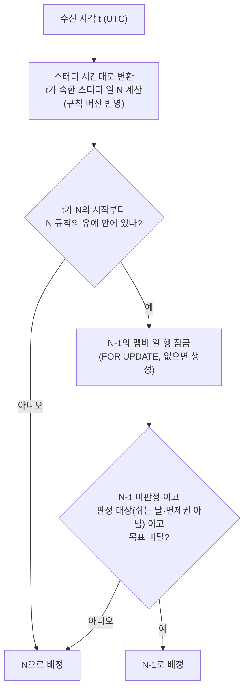

# 5.5 스터디 일 배정 (P1)

**목적:** 풀이를 어느 날의 것으로 셀지 규칙 (R4)대로 정확히 정한다.

**만들 것**

- 시간 계산은 `common.time` 한 곳에: 규칙 하나는 `StudyCalendar`, 규칙 버전에 걸친 계산은 `RuleVersionCalendar`
  (`studyDayOf(t)`, `startOf(day)`, `isInGrace(t)`, `judgeAt(day)`. 알림 시각 `reminderAt(day)`은 S13)
- 배정 함수: 규칙은 **그날의 규칙 버전**을 써요 (전날 목표는 전날 규칙으로)
- `member_days` 행 upsert: `INSERT ... ON CONFLICT DO NOTHING` 후 `SELECT ... FOR UPDATE`

**주의할 것**

- **동시성:** 목표 1문제인 멤버의 push 두 개가 00:05에 동시에 오면, 둘 다 전날로 가서 오늘이 0이 될 수 있어요. 전날 멤버 일 행을 잠그고 그 안에서 확인하면 첫 번째만 전날로 가요.
- **잠금 순서**는 항상 '전날 행 → 오늘 행'이에요. 순서가 섞이면 교착 상태가 나요.
- 판정 배치도 같은 멤버 일 행을 잠가요. 그래서 '미판정' 확인과 판정이 서로 끼어들 수 없어요.
- 판정 시각을 '기준 시각 + 유예 + 여유 10분'으로 잡아서, 유예 안에 들어온 웹훅은 판정 전에 처리돼요. 유예 구간과 판정 시각은 같은 날(유예 구간이 시작되는 날 N)의 규칙의 유예를 써요 (R4, R9).
- `LocalDate.now()`를 직접 부르지 않아요. 항상 주입된 `Clock`을 써야 시간 테스트가 돼요.

**테스트:** T6, T7, T8, T11, T25
