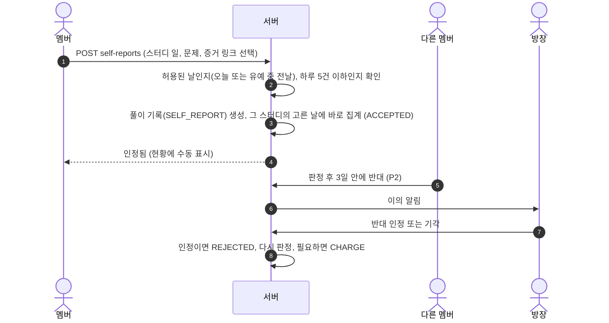

# 5.6 수동 인증 (P1)

**목적:** GitHub를 안 쓰거나 GitHub에 문제가 있어도 인증할 수 있게 하되, 방장 일을 늘리지 않는다.

**만들 것**

- 수동 인증 API와 화면, 현황의 '수동' 표시
- 판정 전 본인 철회
- 스터디 규칙의 '승인 필요' 모드 (방장 승인함은 이 모드에서만). 승인 API(api.md 4.4)가 생기기 전까지는 이 모드의 수동 인증을 409로 거절해요 (알려진 충돌 6번)
- 멤버별 수동 인증 비율을 방장에게 보여주기 (신뢰 지표). 그날이 속한 기수에서 센 풀이 중 인정된 수동 인증의 비율이에요. 오늘 현황은 이번 기수, 지난 날 상세는 그날이 속한 기수예요

**주의할 것**

- 지난 날짜를 마음대로 고를 수 없게 해요. 오늘, 또는 유예 중인 전날만 돼요. 유예 중인 전날은 R4가 그 시각의 풀이를 전날로 보낼 때(판정 대상, 쉬는 날 아님, 판정 전, 면제권 안 씀, 목표 미달)만 돼요 (R7).
- 요청한 스터디의 고른 날에만 세요. push처럼 모든 스터디에 R4로 넣지 않아요 (pseudocode `recordSolve`를 쓰지 않음). 세는 방법은 S09의 멤버 일 잠금·다시 세기예요.
- 철회할 때 같은 문제의 다른 풀이로 바꿔 끼우거나, 다음 날 유예 안에 같은 문제 풀이(수동 인증 아님)가 있으면 철회를 막아요 (R7).
- 증거 링크는 `http`, `https`만 허용해요. 서버는 이 링크에 접속하지 않아요 (표시만).
- 판정 후 결과를 바꾸는 일은 이의 (P2)로만 해요. 직접 고치면 원장과 어긋나요.

**테스트:** T29
