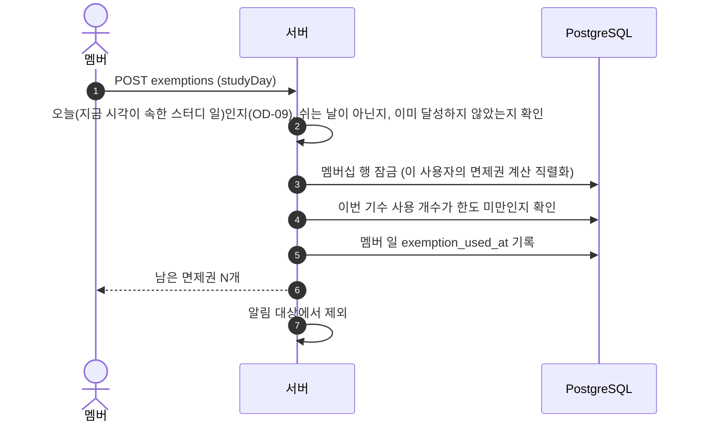

# 5.7 면제권 (P1)

**목적:** 실제 스터디의 '면제권' 규칙을 그대로 자동화해 중도 이탈을 줄인다.

**만들 것**

- 사용·취소 API, 남은 개수 표시
- 판정 때 '면제권 + 달성 = 성공 + 반환' 처리 (R8)
- 현황에 "OO님 면제권 사용" 표시

**주의할 것**

- **마지막 면제권 경쟁:** 남은 1개를 서로 다른 날짜에 동시에 쓰면 두 요청 모두 '1개 남음'을 볼 수 있어요. 멤버 일 행은 날짜마다 달라서 그 잠금으로는 못 막아요. **멤버십 행을 잠가** 이 사용자의
  면제권 계산을 한 줄로 세워요.
- 같은 날 두 번 누르는 건 멤버 일 행 하나라 자연히 막혀요.

**테스트:** T12, T13
