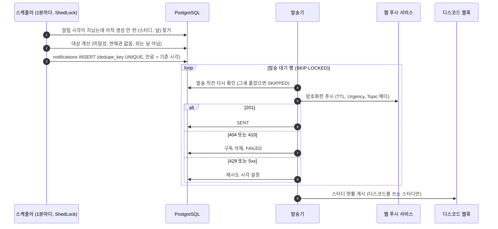
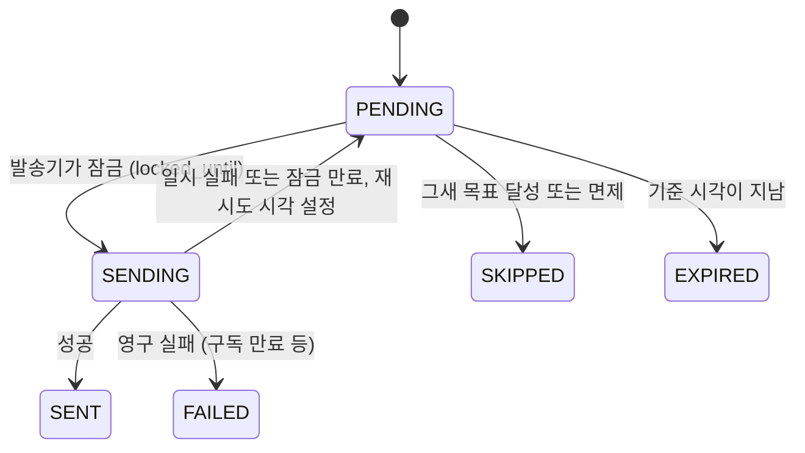

# 5.8 마감 전 알림 (P1)

**목적:** 아직 못 푼 사람에게만, 마감 전에 한 번, 확실히 알린다.

**알림 종류**

| 종류                   | 받는 사람      | 채널               | 시점                    | dedupe_key                      |
|------------------------|----------------|--------------------|-------------------------|---------------------------------|
| REMINDER               | 미달성 멤버    | 웹 푸시            | 그날 마감(다음 날 기준 시각) − 그날 규칙의 알림 오프셋 | `REMINDER:{study}:{user}:{day}` |
| SHARE_PROMPT           | 방장           | 웹 푸시            | 같은 시점               | `SHARE_PROMPT:{study}:{day}`    |
| DISCORD_STATUS         | 스터디 채널    | 디스코드           | 같은 시점               | `DISCORD_STATUS:{study}:{day}`  |
| DAILY_RESULT           | 채널 또는 방장 | 디스코드 / 웹 푸시 | 판정 직후               | `DAILY_RESULT:{study}:{day}`    |
| RULE_CHANGED           | 멤버           | 웹 푸시            | 규칙 변경 시            | `RULE:{study}:{ruleId}:{user}`  |
| WEEKLY_SETTLEMENT (P2) | 채널 또는 방장 | 디스코드 / 웹 푸시 | 월요일 09:00            | `WEEKLY:{study}:{week}`         |
| APPEAL (P2)            | 방장, 신청자   | 웹 푸시            | 신청, 결정              | `APPEAL:{id}:{event}`           |
| SEASON_SUMMARY (P3)    | 멤버 전체      | 웹 푸시 / 디스코드 | 기수 정산 확정          | `SEASON:{study}:{seq}`          |

**만들 것**

- 스케줄러 (생성)와 발송기 (전송)를 분리 (outbox 방식)
- 웹 푸시: VAPID 키 생성, 구독 등록 API, 암호화 발송 (Java 라이브러리는 유지보수 상태를 보고 ADR-008로 결정)
- 서비스 워커: `push` 이벤트에서 알림 표시, 알림을 누르면 오늘 현황 열기
- 디스코드 웹훅 발송: 임베드 메시지
- 알림 설정 화면: 권한 요청, iOS 홈 화면 안내, 테스트 알림
- 지표: 발송 성공률, 구독 만료 정리 건수, **알림 전환율**(알림을 받고 마감 전에 푼 비율)

**주의할 것**

- **'정확히 한 번'은 불가능해요.** 외부로 보낸 뒤 '보냈다'를 기록하기 전에 서버가 죽으면 다시 보낼 수밖에 없어요. 그래서 목표를 이렇게 잡아요: 중복 생성 금지 (dedupe_key) + 실패 시 재시도
  (적어도 한 번) + 발송 직전 재확인. 알림 한 번이 중복되는 건 괜찮지만 빠지는 건 안 돼요.
- **늦게 깨어나도 의미 있게:** 서버가 21:50~23:30에 꺼져 있었다면, 켜질 때 아직 마감 전이면 보내고 마감이 지났으면 EXPIRED로 둬요.
- **TTL을 기준 시각까지로** 잡아요. 기기가 꺼져 있다가 다음 날 켜졌을 때 지난 알림이 뜨지 않아요.
- `Topic` 헤더로 같은 날 알림은 새것이 옛것을 덮게 해요.
- payload는 작게 (수 KB), 개인정보는 최소로 해요. 예: "오늘 1문제 남았어요, 24시 마감"
- **VAPID 키는 한 번 만들면 바꾸지 않아요.** 바꾸면 기존 구독이 전부 무효가 돼요. 개인키는 비밀로 보관해요 (9.6).
- **iPhone:** iOS 16.4 이상에서 홈 화면에 추가한 뒤에만 받을 수 있어요 [S30]. 권한 요청은 사용자가 버튼을 눌렀을 때만 할 수 있어요. 홈 화면 추가 안내를 화면에 넣어요.
- 권한 요청은 첫 방문이 아니라 **스터디에 가입한 직후**처럼 이유가 분명할 때 해요. 한 번 거부되면 다시 묻기 어려워요.
- `sw.js`는 캐시하지 않게 해요 (`Cache-Control: no-cache`). 캐시되면 서비스 워커 수정이 사용자에게 반영되지 않아요.
- 알림이 많으면 사람들은 꺼 버려요. 기본은 하루 한 번이에요.
- **디스코드:** 이름에 `@everyone`을 넣는 장난을 막으려고 `allowed_mentions`를 비워서 보내요. 429는 응답의 재시도 시간만큼 기다리고, 404면 웹훅이 지워진 것이라 비활성화하고
  방장에게 알려요.

**테스트:** T14, T15, T16, T17, T18
