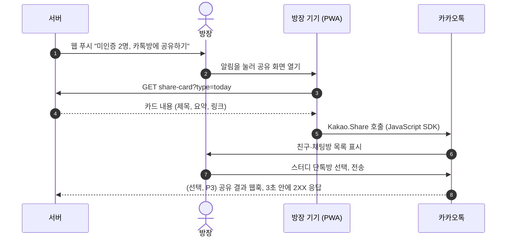

# 5.9 현황 공유: 카카오톡 공유와 디스코드 (P1)

**목적:** 스터디가 실제로 있는 곳 (카톡방, 디스코드)으로 현황을 보낸다.



**카드 예시**

```
[11/20 코테 인증 현황]
완료 5명 · 남음 2명 (민수, 지은) · 마감 24:00
[현황 보기] → https://(도메인)/studies/12/today  (로그인한 멤버만 볼 수 있음)
```

**만들 것**

- 공유 카드 API (`today`, P2부터 `weekly`)
- 카카오 디벨로퍼스 앱 등록, 웹 플랫폼 도메인 등록, JavaScript SDK 연동
- 디스코드 임베드 메시지 (같은 내용, 자동 게시)
- 공유가 안 되는 환경을 위한 '텍스트 복사' 버튼
- (P3, 선택) 카카오톡 공유 결과 웹훅으로 공유율 측정

**주의할 것**

- 카카오톡 공유는 **사용자가 직접 대상을 고르는 방식이라 자동화할 수 없어요** [S28]. 대신 검수가 필요 없어요 [S27]. 그래서 방장이 알림 → 버튼 → 방 선택까지 3번 안에 끝나게 화면을 만들어요.
- 공유 결과 웹훅을 받으려면 **3초 안에 2XX로 응답**해야 해요 [S29]. 웹훅 수신 구조 (5.3)를 그대로 써요.
- JavaScript 키는 화면에 드러나는 값이에요. 대신 등록한 도메인에서만 동작하니 **운영 도메인만 등록**하고, 개발용은 앱을 따로 만들어요.
- CSP (9.7)에 카카오 SDK 스크립트 도메인을 허용해야 해요. 정확한 도메인은 SDK 문서로 확인해요.
- **오픈채팅방이 공유 대상에 뜨는지는 사람이 직접 확인해요 (사람 할 일 H-06).** 안 뜨면 '텍스트 복사'가 오픈채팅 스터디의 기본 경로가 돼요.
- 카드에는 멤버 이름이 들어가요. 스터디 안에서 공유되는 정보지만, 벌금 금액은 기본으로 빼고 방장이 켤 때만 넣어요.
