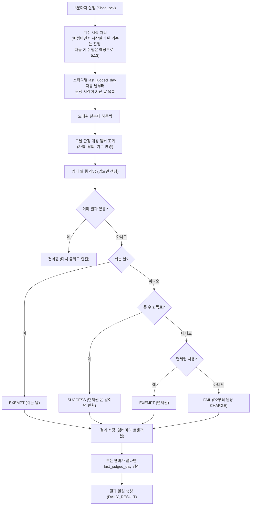

# 5.10 일일 판정 배치 (P1)

**목적:** 매일 각 멤버의 성공·실패·면제를 정확히, 한 번만 정한다.

**처리 순서**

1. 판정 시각 = (D+1)의 기준 시각 + 유예 + 여유 10분이에요.
2. '어제를 판정'이 아니라 '**아직 판정 안 한 날을 전부 판정**'이에요. 서버가 사흘 꺼져 있었으면 켜질 때 사흘치를 오래된 순서로 판정해요.
3. 멤버마다 트랜잭션을 나눠요. 한 멤버에서 오류가 나도 다른 멤버 판정은 진행돼요. 하루치가 전부 끝나야 `last_judged_day`를 올려요.
4. 판정 전에 스터디마다 기수 시작 처리를 해요. 예정이면서 시작일이 된 기수는 진행으로 바꾸고, 마지막 기수 행이 시작됐으면 다음 기수 행을 예정으로 만들어요 (5.13). 다시 돌려도 안전해요. 따라잡기 판정이 행 없는 날을 기수 밖으로 건너뛰지 않게 판정보다 먼저 해요. 스터디 행을 잠그고, 판정과 따로 짧은 트랜잭션으로 해요 (결정 제안서 006).

**만들 것**

- 판정 배치, ShedLock 설정 (락 유지 시간 > 예상 실행 시간)
- 기수 시작 처리 (처리 순서 4, 5.13)
- 판정 대상 조회 쿼리 (멤버십 기간, 기수, 규칙 버전 반영)
- 결과 알림 생성
- 지표: 배치 소요 시간, 따라잡은 날 수, 실패 건수
- 관리자 명령: 특정 날 다시 판정 (결과가 있는 행은 건너뜀)

**주의할 것**

- **다시 돌려도 안전해야 해요 (멱등).** 결과가 이미 있으면 건너뛰고, 유니크 제약이 마지막 방어선이에요.
- **늦게 온 풀이와 경합:** 배정 (5.5)과 판정이 같은 멤버 일 행을 잠가요.
- 그날 적용되는 규칙 버전을 써요. 오늘 규칙으로 어제를 판정하면 안 돼요.
- 대량 조회로 N+1을 피해요. 멤버 목록, 멤버 일, 면제권을 스터디·날짜 단위로 한 번에 가져와요.
- 한국은 서머타임이 없지만 다른 시간대 스터디를 위해 날짜 계산은 `ZonedDateTime`으로 해요.

**테스트:** T8, T9, T10, T11, T13
