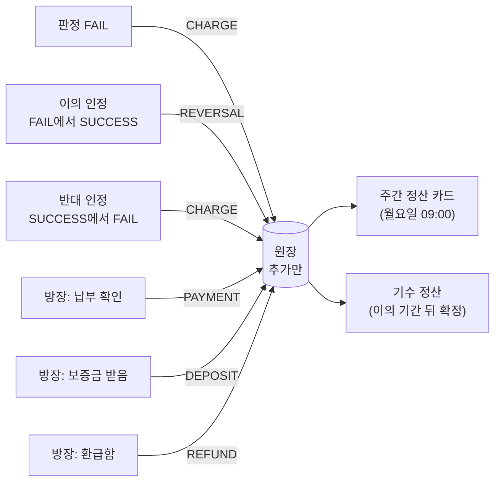

# 5.11 정산과 원장 (P2)

**목적:** 벌금·보증금 기록이 언제나 맞고, 왜 그 금액인지 설명할 수 있게 한다.

| 기록 종류                  | 만드는 주체 | idempotency_key                               |
|----------------------------|-------------|-----------------------------------------------|
| CHARGE (판정)              | 판정 배치   | `JUDGE:{memberDayId}`                         |
| REVERSAL / CHARGE (정정)   | 이의 결정   | `APPEAL:{appealId}`                           |
| PAYMENT / DEPOSIT / REFUND | 방장        | 요청 헤더 `Idempotency-Key`(화면이 만든 UUID) |

- 벌금 방식: 낼 돈 = CHARGE − REVERSAL − PAYMENT (R12)
- 보증금 방식: 돌려받을 돈 = DEPOSIT − (CHARGE − REVERSAL) − REFUND

**만들 것**

- 원장 엔티티와 저장소 (수정·삭제 메서드를 아예 만들지 않음)
- 판정 배치에 CHARGE 추가
- **P1 기간 백필:** 결과가 FAIL인데 원장에 없는 멤버 일을 CHARGE로 옮기는 작업 (idempotency_key 덕분에 다시 돌려도 안전)
- 방장 기록 API (납부·보증금·환급), 원장 조회, 주간·기수 정산 스냅샷
- 주간 정산 카드 공유 (5.9와 같은 방식)

**주의할 것**

- **원장은 추가만 해요.** 앱에 수정·삭제 코드가 없어도, DB 계정 권한에서도 UPDATE·DELETE를 회수해 두면 실수까지 막아요.
- 금액은 원 단위 정수로 다뤄요. 소수점이 생길 일이 없게 규칙을 만들어요.
- 정산 카드는 만든 시점의 스냅샷이에요. 이후 정정은 다음 카드에 반영돼요.
- 초과 납부 (음수 잔액)도 그대로 보여줘요. 숨기면 오히려 분쟁이 생겨요.
- 화면마다 "서비스는 돈을 받거나 보내지 않아요"라고 안내해요 (D6).

**테스트:** T22, T23, '잔액 = 원장 합' 검증 테스트
