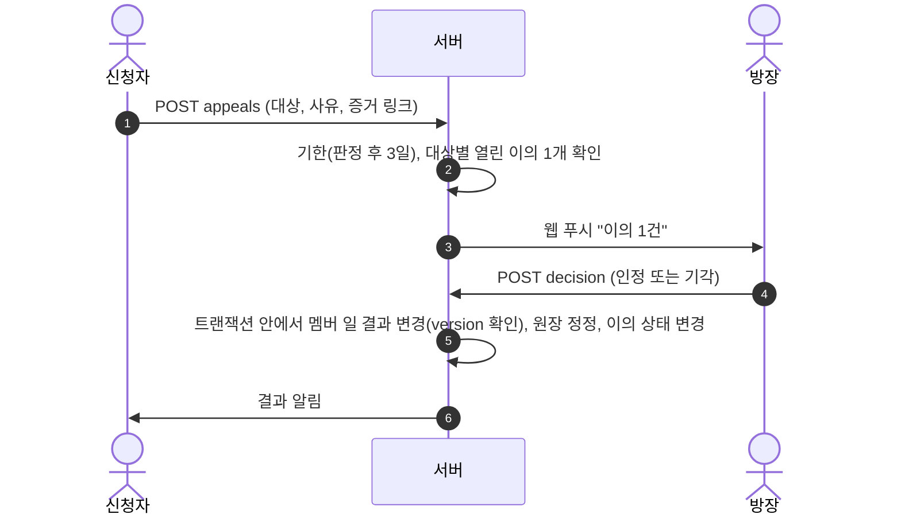

# 5.12 이의 처리 (P2)

**목적:** 잘못된 판정을 공정하게 바로잡고, 그 과정이 기록으로 남게 한다.

**만들 것**

- 이의 신청·결정 API, 이의함 화면
- 복구 작업 (5.14)이 찾은 근거를 이의 화면에 보여주기 (예: "GitHub 기록상 23:59에 push됨")

**주의할 것**

- **동시 결정:** 같은 이의를 두 번 누르거나, 이의 결정과 다른 정정이 겹칠 수 있어요. 멤버 일의 `version`으로 충돌을 감지하고, 충돌하면 409로 다시 시도하게 해요.
- 방장 본인 관련 건과 결정하지 않은 건은 Q4에서 정한 대로 해요.
- 누가 언제 결정했는지 (`decided_by`, `decided_at`)를 남겨요. 분쟁 때 근거가 돼요.

**테스트:** T22
