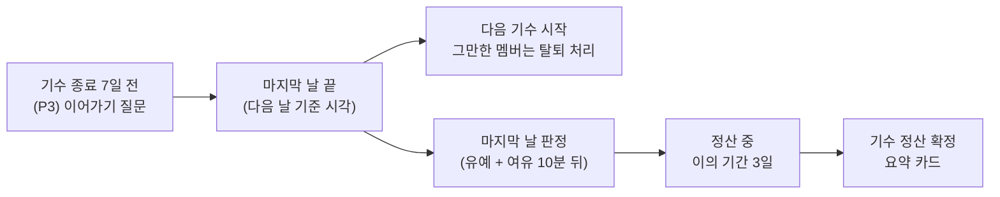

# 5.13 기수 운영 (P1 자동 연장, P3 이어가기)

**목적:** 4주 단위로 시작과 끝이 있는 스터디를 만들어 완주와 재참여를 돕는다.

**만들 것**

- P1: 기수가 끝나면 같은 규칙(다음 기수부터 적용하기로 한 변경 포함, R2)으로 다음 기수를 자동 생성하고 마지막 날 다음 날 바로 시작 (스터디가 멈추지 않게, OD-07)
- P3: 이어가기 질문과 응답, 응답하지 않은 멤버의 기본 처리 (Q11과 함께 결정)
- P3: 기수 요약 카드 (완주율, 총 풀이 수, 가장 긴 스트릭, 정산)

**주의할 것**

- 기수 경계에서 면제권 개수가 초기화돼요. 경계일 계산은 `StudyCalendar` 한 곳에서 해요.
- 정산 확정은 이의 기간이 끝난 뒤예요. 그 전에 확정하면 정정할 수 없어요.
- 다음 기수는 정산 확정을 기다리지 않아요. 이전 기수가 정산 중(이의 3일)인 동안 다음 기수가 진행돼요 (OD-07).
- 하루 기준 시각이 바뀌는 기수 경계에서는 새 기수 첫날의 길이가 달라져요 (18~30시간, R2, OD-08).
