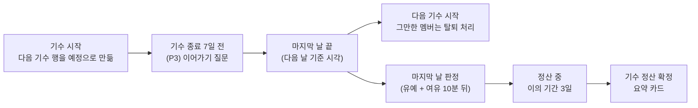

# 5.13 기수 운영 (P1 자동 연장, P3 이어가기)

**목적:** 4주 단위로 시작과 끝이 있는 스터디를 만들어 완주와 재참여를 돕는다.

**만들 것**

- P1: 같은 규칙(다음 기수부터 적용하기로 한 변경 포함, R2)으로 다음 기수를 자동 생성하고 마지막 날 다음 날 바로 시작 (스터디가 멈추지 않게, OD-07)
- P1: 다음 기수 행은 이번 기수가 시작될 때 예정(`SCHEDULED`)으로 만들어 둬요. 늘 한 기수 앞서 있어요. 시작일이 된 기수는 진행(`ACTIVE`)으로 바꿔요. 둘 다 판정 배치(5.10)가 판정 전에 하고, 다시 돌려도 기수 행은 하나예요 (`(study_id, seq)` UNIQUE). 1기 행은 스터디를 만들 때 만들어요
- P3: 이어가기 질문과 응답, 응답하지 않은 멤버의 기본 처리 (Q11과 함께 결정)
- P3: 기수 요약 카드 (완주율, 총 풀이 수, 가장 긴 스트릭, 정산)

**주의할 것**

- 기수 경계에서 면제권 개수가 초기화돼요. 경계일 계산은 `StudyCalendar` 한 곳에서 해요.
- 정산 확정은 이의 기간이 끝난 뒤예요. 그 전에 확정하면 정정할 수 없어요.
- 다음 기수는 정산 확정을 기다리지 않아요. 이전 기수가 정산 중(이의 3일)인 동안 다음 기수가 진행돼요 (OD-07).
- 하루 기준 시각이 바뀌는 기수 경계에서는 새 기수 첫날의 길이가 달라져요 (18~30시간, R2, OD-08).
- 다음 기수 행을 마지막 날 판정 뒤에 만들면 안 돼요. 새 기수 첫날은 마지막 날이 끝나는 순간(다음 날 기준 시각)에 시작하는데, 마지막 날 판정은 그보다 유예 + 10분 늦어요. 그 사이(최대 130분) 새 첫날이 기수 밖이 되어 배정(5.5)의 판정 대상, `member_days.season_id`, R9 '기수 안의 날만'이 어긋나요.
- 기수 중에 기수 길이를 바꾸면 이미 만든 다음 기수 행(예정)의 끝 날짜를 새 길이로 다시 세요. 시작한 기수의 끝 날짜는 바꾸지 않아요 (R2).
- 다음 기수 행이 이미 있어도, 다음 기수부터 적용하는 규칙 변경은 그 기수(아직 시작 전)에 적용해요 (R2). 행이 있는지는 적용 기수를 바꾸지 않아요.
- 기수 시작 처리와 규칙 변경은 스터디 행 잠금으로 차례로 실행해요 (결정 제안서 006). 그래야 기수 시작 처리가 옛 기수 길이로 행을 만드는 사이에 길이 변경이 끼어들지 않아요.
