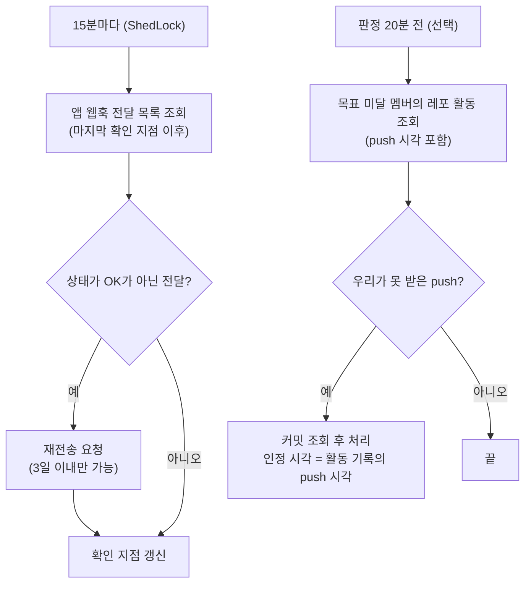

# 5.14 누락 복구 (P2)

**목적:** 웹훅이 빠져도 사용자가 손해 보지 않게 한다.

**처리 순서**

1. **재전송:** 앱 웹훅의 전달 목록을 조회해서 실패한 전달을 재전송 요청해요. GitHub 문서도 이렇게 주기적으로 돌리는 스크립트를 안내해요 [S34]. 재전송된 전달은 inbox의 delivery_id
   중복 제거로 한 번만 처리돼요.
2. **대조 (선택):** 판정 직전에 목표 미달 멤버의 레포 활동 목록 (push와 시각)을 조회해서 [S40], 우리가 받지 못한 push가 있으면 그 커밋을 처리해요. 출처는 `RECOVERY`로 표시해요.

**주의할 것**

- **3일이 지난 전달은 재전송할 수 없어요** [S35]. 그래서 하루 한 번이 아니라 15분마다 돌려요. 서버가 사흘 넘게 꺼져 있었다면 대조 (2번)로만 메울 수 있어요.
- 전달 목록 조회는 앱 JWT로, 레포 활동 조회는 설치 토큰으로 해요. 요청 한도를 생각해 대조는 '목표 미달 멤버'만 해요 [S38].
- **인정 시각:** 복구된 풀이는 GitHub 활동 기록의 push 시각을 써요 (R3 예외). 커밋 시각은 작성자가 바꿀 수 있어서 쓰지 않아요.
- **복구 건수 = 웹훅 누락률**이에요. 이 숫자가 'inbox와 복구 작업을 왜 만들었는지'의 근거가 돼요.

**테스트:** '웹훅 하나를 일부러 버린 뒤 복구 작업이 메우는지' 통합 테스트 (WireMock으로 GitHub API 흉내)
