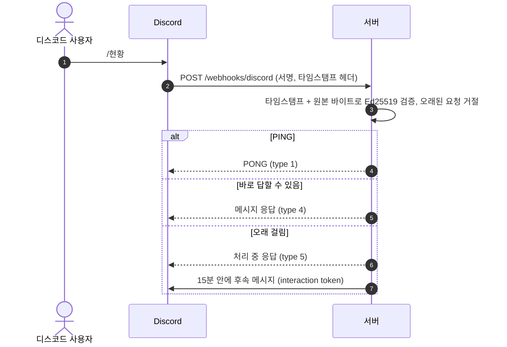

# 5.15 디스코드 명령 (P3, 선택)

**목적:** 디스코드 스터디는 디스코드 안에서 `/현황`, `/면제`로 끝내게 한다.

**만들 것**

- 명령 등록 (개발 중에는 서버 단위 명령으로 빠르게 반영)
- 계정 연결: 웹에서 1회용 코드 발급 → 디스코드에서 `/연결 코드`
- Ed25519 서명 검증 [S32], interaction id 중복 제거 (inbox, source=DISCORD)

**주의할 것**

- **3초 안에 첫 응답**을 보내지 않으면 실패로 처리되고 토큰도 무효가 돼요. 첫 응답 뒤 토큰은 15분 유효해요 [S31].
- Java는 JDK 15부터 Ed25519를 기본 지원해요. 디스코드가 주는 공개키는 32바이트 원본 (hex)이라 X.509 형식으로 감싸서 `KeyFactory`에 넣어야 해요. 이 변환을 놓치면 검증이 항상
  실패해요.
- 서명 헤더는 GitHub와 달라요 (`X-Signature-Ed25519`, `X-Signature-Timestamp`) [S32]. 수신 구조는 공통으로, 검증기만 소스별로 둬요 (6장 ①).

**테스트:** T24
