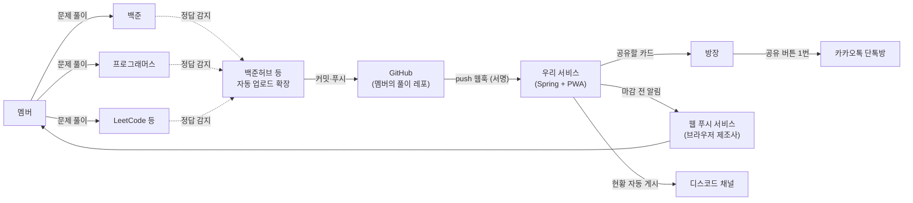
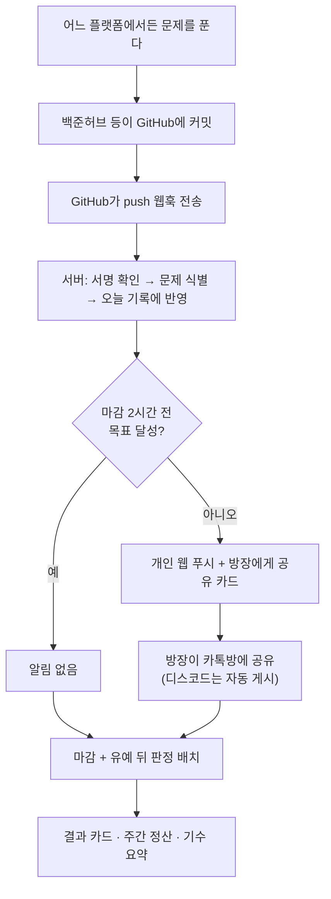
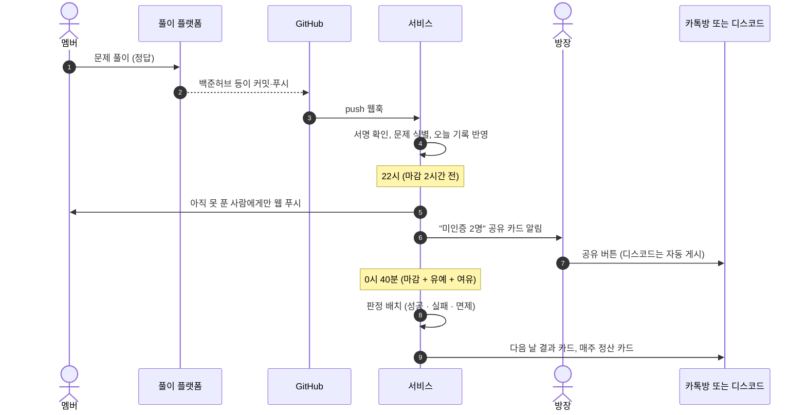
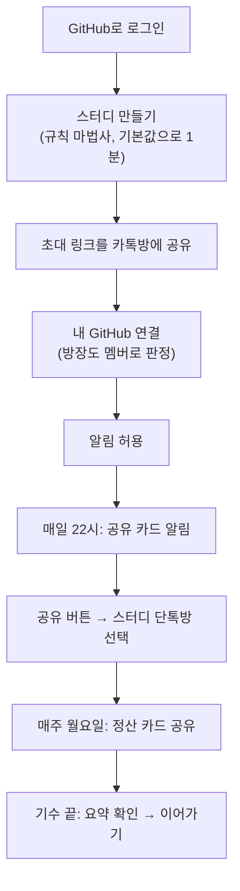
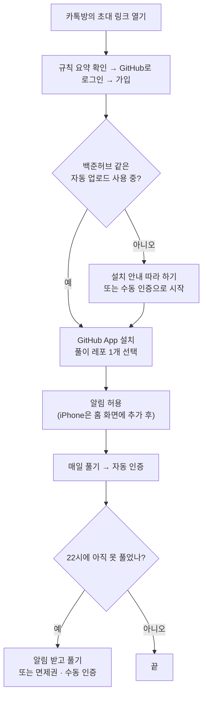
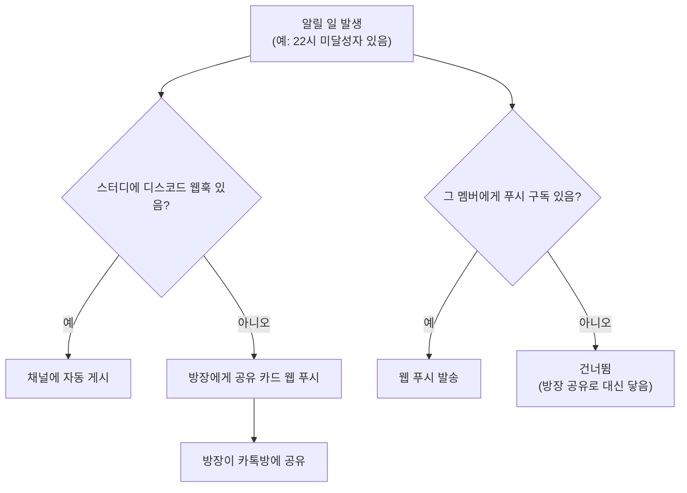

# 제품 정의

> 스펙 문서예요. 사람이 정한 내용만 담아요. 에이전트는 사람이 정한 결정을 `docs/` 브랜치의 문서 전용 PR로 반영하고, 그 밖에 바꿀 게 있으면 PR의 '스펙 변경 제안'에 적어요 (`docs/workflow.md` 4장).

## 한 줄 정의

**풀기만 하면 인증·알림·정산은 봇이 하는 코딩테스트 스터디 서비스.**

멤버가 어느 플랫폼에서든 문제를 풀면 백준허브 같은 확장이 풀이를 GitHub에 커밋하고, 서비스는 GitHub push 웹훅으로 자동 인증해요. 마감 2시간 전에는 아직 못 푼 사람에게만 알리고, 마감 뒤에는 매일 판정해요. 방장은 확인·집계·독촉을 하지 않고 공유 버튼만 눌러요.

## 왜 만드나

- 코테 스터디는 대부분 '매일 인증 + 면제권 + 벌금' 규칙을 카톡방과 스프레드시트로 손으로 굴려요. 멤버는 정답 화면을 캡처해 올리고, 방장은 확인하고, 시트에 적고, 벌금을 계산하고, 미인증자를 독촉해요.
- 수요는 '확인·집계·독촉의 자동화'와 '잊지 않게 해 주기'에 있어요. 벌금은 수단이지 목적이 아니에요.
- 차별점은 세 가지예요.
    1. **손이 덜 감:** 설정은 한 번, 그 뒤로는 자동
    2. **플랫폼 무관:** GitHub를 거치면 백준·프로그래머스·LeetCode 어디서 풀든 인증. 2026년에 백준이 멈췄던 것처럼 플랫폼은 멈출 수 있어요
    3. **스터디가 있는 곳으로 결과를 보냄:** 카카오톡 공유, 디스코드 자동 게시

## 개발 원칙

1. **사용자가 할 일을 줄이는 기능이 먼저다.** 방장 승인함처럼 일을 늘리는 기능은 뒤로 미룬다.
2. **기능 수보다 깊이.** 한 기능을 테스트, 장애 상황, 측정까지 끝낸다.
3. **결정은 기록한다.** 선택지 비교 → 이유 → 비용 → 검증.
4. **진실의 원천은 DB 상태다.** 이벤트와 알림은 최적화이고, 배치가 다시 계산해서 맞출 수 있어야 한다.
5. **프론트에는 개발 시간의 20% 이상 쓰지 않는다.**
6. **'하지 않는 것' (2.4)을 지킨다.**

## 범위 한눈에 보기

| 단계 | 내용 |
|---|---|
| P1 첫 운영 루프 | 로그인, 스터디·규칙·기수·초대, GitHub App 연결, push 자동 인증, 스터디 일 배정, 수동 인증, 면제권, 판정 배치, 마감 전 알림(웹 푸시), 디스코드·카톡 공유, 탈퇴, PWA 화면 |
| P2 신뢰성과 정산 | inbox 비동기 처리, 누락 복구, 원장·정산, 이의 |
| P3 유지 기능 | 기수 이어가기·요약, 스트릭·통계, 디스코드 명령 |
| P4 운영 | 운영 지표, 성능 측정, 개선 |

기능별 단계와 우선순위는 2.3에 있고, 실제 작업 순서는 `docs/steps/README.md`에 있어요.

## 0.3 전체 그림

## 0.4 핵심 루프

## 2.1 사용자와 하려는 일

| 사용자              | 하려는 일                          | 지금의 고통                                           | 이 서비스가 주는 것                           | 도입을 막는 것                       |
|---------------------|------------------------------------|-------------------------------------------------------|-----------------------------------------------|--------------------------------------|
| **방장** (결정권자) | 스터디를 끝까지 굴리고 싶다        | 매일 캡처 확인, 시트 기록, 벌금 계산, 독촉, 송금 요청 | 확인·집계·독촉은 자동, 할 일은 공유 버튼 하나 | 멤버들에게 GitHub 연결을 부탁해야 함 |
| **멤버**            | 매일 꾸준히 풀고, 벌금은 내기 싫다 | 캡처 2장, 마감을 잊음                                 | 풀기만 하면 인증, 마감 전 알림, 스트릭        | GitHub 연결, 알림 허용               |
| **혼자 하는 사람**  | 혼자서도 꾸준히 하고 싶다          | 강제력이 없음                                         | 알림, 스트릭, 기록                            | 동기가 약함                          |

- **방장이 도입해야 멤버가 들어와요.** 방장 설득 포인트는 "오늘부터 확인·계산·독촉 안 해도 돼요"예요.
- 멤버 설득 포인트는 "캡처 안 해도 되고, 마감 전에 알려 줘요"예요.
- 혼자 쓰기는 방장이 되기 전 '맛보기' 역할도 해요. 혼자 써 보고 좋으면 스터디를 만들게요.

## 2.2 가치 제안과 하루 흐름

> **"풀기만 하세요. 인증·알림·정산은 봇이 합니다."**

## 2.3 기능 목록과 우선순위

필수 = 없으면 운영이 안 됨 · 중요 = 매력을 크게 올림 · 선택 = 여유가 있으면

| 영역     | 기능                                                                   | 단계 | 우선순위 |
|----------|------------------------------------------------------------------------|------|----------|
| 계정     | GitHub 로그인, 탈퇴                                                    | P1   | 필수     |
| 스터디   | 만들기(규칙 마법사), 혼자 쓰기 모드, 초대 링크, 규칙 변경(다음 날부터, 일부는 다음 기수부터) | P1   | 필수     |
| 스터디   | 기수(4주) 자동 생성·연장                                               | P1   | 필수     |
| 인증     | GitHub App 연결, push 자동 인증                                        | P1   | 필수     |
| 인증     | 문제 식별 + '확인 대기' 지정                                           | P1   | 필수     |
| 인증     | 수동 인증 (바로 인정)                                                  | P1   | 필수     |
| 현황     | 오늘 현황 (멤버별 완료·남음·면제)                                      | P1   | 필수     |
| 면제권   | 사용·취소, 달성 시 자동 반환                                           | P1   | 중요     |
| 판정     | 일일 판정 배치                                                         | P1   | 필수     |
| 알림     | 마감 전 웹 푸시 (못 푼 사람만)                                         | P1   | 필수     |
| 알림     | 방장 공유 카드 + 카카오톡 공유                                         | P1   | 중요     |
| 알림     | 디스코드 채널 웹훅 자동 게시                                           | P1   | 중요     |
| 정산     | 미인증 횟수 × 금액 표시                                                | P1   | 중요     |
| 정산     | 원장(벌금·정정·납부·보증금·환급), 주간 정산 카드                       | P2   | 중요     |
| 이의     | 판정 정정 요청, 수동 인증 반대                                         | P2   | 중요     |
| 운영     | inbox + 비동기 처리, 누락 복구, 운영 지표                              | P2   | 필수     |
| 기수     | 기수 요약 카드, 이어가기 확인                                          | P3   | 중요     |
| 기록     | 스트릭(P1은 숫자만), 달력·플랫폼 분포 통계                             | P3   | 선택     |
| 디스코드 | `/현황`, `/면제` 명령                                                  | P3   | 선택     |
| 알림     | 두 번째 알림, 방해 금지 시간                                           | P3   | 선택     |

## 2.4 하지 않는 것

- 실제 돈 받기·보관·환급 (D6)
- 문제 제공, 채점, 문제 추천 (플랫폼의 역할)
- 풀이 플랫폼 크롤링, 비공식 카톡 자동화 (메신저 봇, PC 매크로): 약관 위반과 계정 위험
- 카카오 메시지 API로 자동 발송 (D18)
- 모바일 네이티브 앱 (PWA로 충분)
- 난이도 조건 (Q3, 이후 검토)
- MSA, 메시지 브로커 (Kafka 등)
- AI 기능 (P4 이후 선택)
- 코드 리뷰·풀이 공유·랭킹을 메인으로

## 2.5 사용자 여정

**방장**

**멤버**

**전환 깔때기:** 어디서 사람이 빠지는지 단계별로 재요. 목표는 가설이에요. P1 운영 2주 뒤 실제 값으로 고쳐요.

| 단계                    | 측정                               | 목표(가설) | 이탈 원인 가설                            | 대응                                                  |
|-------------------------|------------------------------------|------------|-------------------------------------------|-------------------------------------------------------|
| 초대 링크 열기 → 로그인 | 로그인 수 ÷ 링크 열기 수           | 80%        | GitHub 로그인 거부감                      | 랜딩에 "받는 정보: GitHub ID·이름·프로필 사진뿐" 표시 |
| 로그인 → 가입           | 가입 ÷ 로그인                      | 95%        | 규칙이 부담됨                             | 가입 전에 규칙 요약 표시                              |
| 가입 → GitHub 연결      | 연결 ÷ 가입                        | 70%        | 백준허브 미사용, 설치가 복잡              | 단계별 안내, 수동 인증으로도 시작 가능                |
| 연결 → 첫 자동 인증     | 첫 자동 인증 ÷ 연결                | 90%        | 레포·브랜치 설정 오류, 지원 안 하는 형식  | 연결 직후 '테스트 커밋 확인' 화면, 확인 대기 지정     |
| 가입 → 알림 허용        | 푸시 구독 ÷ 가입                   | 60%        | iPhone 홈 화면 추가가 번거로움, 권한 거부 | 맥락 있는 요청, iOS 안내, 방장 공유로 보완            |
| 가입 → 7일 유지         | 7일 뒤에도 풀이가 있는 사람 ÷ 가입 | 70%        | 동기 저하                                 | 알림, 스트릭, 짧은 기수                               |

## 2.6 화면 목록

| #  | 화면           | 핵심 요소                                                                                    | 단계 | 주의                                    |
|----|----------------|----------------------------------------------------------------------------------------------|------|-----------------------------------------|
| 1  | 랜딩           | 한 줄 소개, 로그인, 받는 정보, 개인정보처리방침 링크                                         | P1   | 로그인 전에 무엇을 받는지 보여주기      |
| 2  | 내 스터디      | 목록, 만들기, 오늘 내 상태                                                                   | P1   |                                         |
| 3  | 스터디 만들기  | 모드(그룹·혼자), 목표, 하루 기준 시각, 유예, 쉬는 요일, 벌금 방식, 면제권, 알림 시각, 시작일 | P1   | 기본값만으로 1분 안에 끝나게            |
| 4  | 초대 수락      | 스터디 이름, 규칙 요약, 가입                                                                 | P1   | 규칙을 가입 전에 보여줘야 분쟁이 줄어요 |
| 5  | GitHub 연결    | 단계 안내(백준허브 → 레포 → App 설치), 연결 상태, 테스트 커밋 확인                           | P1   | 가장 이탈이 많을 화면. 가장 공들이기    |
| 6  | 오늘 현황 (홈) | 멤버별 완료·남음·면제, 최근 풀이, 공유 버튼(방장)                                            | P1   | 가장 자주 보는 화면                     |
| 7  | 내 풀이        | 목록, 확인 대기 지정, 수동 인증                                                              | P1   |                                         |
| 8  | 면제권         | 남은 개수, 사용·취소                                                                         | P1   | 마감 시각 표시                          |
| 9  | 스터디 설정    | 규칙(다음 날부터·다음 기수부터 적용 안내), 디스코드 웹훅, 멤버 관리, 방장 위임                             | P1   | 웹훅 URL은 저장 후 다시 보여주지 않기   |
| 10 | 알림 설정      | 푸시 허용, iOS 홈 화면 안내, 테스트 알림                                                     | P1   |                                         |
| 11 | 정산           | 원장, 납부·보증금·환급 기록                                                                  | P2   | "서비스는 돈을 다루지 않아요" 안내      |
| 12 | 이의함         | 신청, 결정                                                                                   | P2   |                                         |
| 13 | 기록·통계      | 스트릭, 달력, 플랫폼 분포                                                                    | P3   |                                         |
| 14 | 기수 요약      | 완주율, 정산, 이어가기                                                                       | P3   |                                         |

## 2.7 알림·공유 채널

| 채널               | 받는 곳       | 자동 여부            | 비용             | 제약                                                                                                                    | 단계      |
|--------------------|---------------|----------------------|------------------|-------------------------------------------------------------------------------------------------------------------------|-----------|
| 웹 푸시 (PWA)      | 개인 기기     | 자동                 | 무료             | iPhone은 iOS 16.4 이상에서 홈 화면에 추가해야 받을 수 있음 [S30]. 사용자가 권한을 거부할 수 있음                        | P1        |
| 카카오톡 공유      | 단톡방        | 반자동 (방장이 버튼) | 무료             | 사용자가 직접 대상을 골라야 함. 이 방식은 검수가 필요 없음 [S27][S28]. 오픈채팅방이 대상 목록에 뜨는지는 사람이 확인 (H-06) | P1        |
| 디스코드 채널 웹훅 | 디스코드 채널 | 자동                 | 무료             | 웹훅 URL이 새면 누구나 글을 올릴 수 있음 → 비밀로 저장                                                                  | P1        |
| 디스코드 명령      | 디스코드      | 사용자가 명령        | 무료             | 3초 안에 첫 응답, 토큰은 15분 유효 [S31]                                                                                | P3        |
| 이메일             | 개인          | 자동                 | 발송 서비스 필요 | 스팸함, 낮은 확인율                                                                                                     | 보류      |
| 카카오 메시지 API  | —             | —                    | —                | 자동 발송 지양, 검수에서 반려될 수 있음 [S27]                                                                           | 쓰지 않음 |

