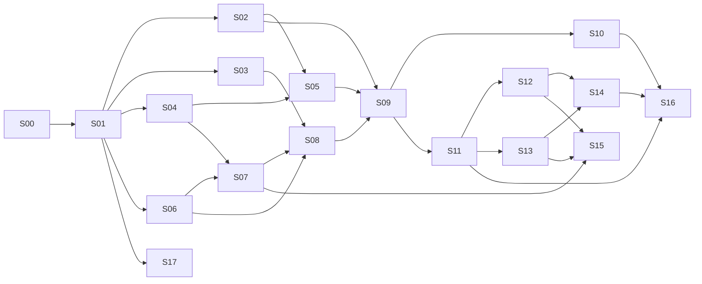

# 단계 로드맵

> 단계의 내용(목표, 범위, 수용 기준)은 사람이 정해요. 단계 PR에서 에이전트는 상태 칸과 수용 기준의 체크 표시만 바꿔요. 사람이 정한 내용을 단계 문서에 옮기는 건 에이전트가 `docs/` 브랜치의 문서 전용 PR에서 해요 (`docs/workflow.md` 4장).

## 진행 규칙

- 한 세션에 단계 하나, 단계 하나에 PR 하나예요. S16(프론트엔드)만 여러 PR로 나눌 수 있어요.
- 선행 단계가 모두 '완료'여야 시작해요. 결정 게이트가 열려 있으면 그 부분은 하지 않아요 (`docs/workflow.md` 3장).
- 완료 기준 = 단계 문서의 수용 기준 + `docs/workflow.md` 6장의 공통 완료 기준.
- 상태 값: `대기` / `진행 중` / `결정 대기` / `완료`.
    - 단계를 끝내는 PR에서 에이전트가 '완료'로 바꿔요. PR이 병합되면 master에서도 '완료'가 돼요.
    - 여러 세션에 걸치면 PR 브랜치에서 '진행 중'으로 두고, 다음 세션은 그 브랜치에서 이어 해요.
- 세션을 시작할 때 열린 PR을 확인해요. 이미 PR이 있는 단계는 새로 시작하지 않아요.

## 로드맵

| 단계 | 이름 | P | 선행 | 결정 게이트 | 사람 할 일 | 상태 |
|---|---|---|---|---|---|---|
| S00 | 첫 커밋: 빌드·테스트·CI 골격 | P1 | — | — | — | 완료 |
| [S01](S01-foundation.md) | 공통 기반 | P1 | S00 | — | H-00, H-09 | 완료 |
| [S02](S02-study-calendar.md) | 시간 계산 (`StudyCalendar`) | P1 | S01 | OD-08 (규칙 전환일만) | — | 완료 |
| [S03](S03-problem-parser.md) | 문제 식별 파서 | P1 | S01 | — | H-01 | 완료 |
| [S04](S04-login-session.md) | 로그인과 세션 | P1 | S01 | OD-01, OD-02, OD-05, OD-06 | H-02 | 완료 |
| [S05](S05-study-membership.md) | 스터디·규칙·기수·초대·멤버십 | P1 | S02, S04 | OD-07, OD-08 | — | 완료 |
| [S06](S06-webhook-receiver.md) | 웹훅 수신 기반 | P1 | S01 | OD-05, OD-06 (먼저 하는 경우) | — | 완료 |
| [S07](S07-github-app.md) | GitHub App 연결 | P1 | S04, S06 | — | H-02 | 완료 |
| [S08](S08-push-to-solve.md) | push 처리와 풀이 기록 | P1 | S03, S06, S07 | — | — | 완료 |
| [S09](S09-study-day-assignment.md) | 스터디 일 배정과 멤버 일 | P1 | S02, S05, S08 | — | — | 완료 |
| [S10](S10-today-status.md) | 오늘 현황·내 풀이·확인 대기 지정 | P1 | S09 | — | — | 대기 |
| [S11](S11-self-report-exemption.md) | 수동 인증과 면제권 | P1 | S09 | OD-09 | — | 대기 |
| [S12](S12-daily-judgment.md) | 판정 배치와 기수 자동 연장 | P1 | S11 | OD-07 | — | 대기 |
| [S13](S13-notification-webpush.md) | 알림 기반과 웹 푸시 | P1 | S11 | OD-11 | H-04 | 대기 |
| [S14](S14-discord-share.md) | 디스코드·결과 알림·공유 카드 | P1 | S12, S13 | — | H-05 | 대기 |
| [S15](S15-account-deletion-admin.md) | 계정 삭제와 운영 도구 | P1 | S07, S12, S13 | — | — | 대기 |
| [S16](S16-frontend.md) | 프론트엔드 (PWA) | P1 | S10, S11, S14 | OD-10 | H-06 | 대기 |
| [S17](S17-deploy-artifacts.md) | 배포 산출물 | P1 | S01 | — | H-07, H-08 | 대기 |

결정을 기다리는 동안 할 수 있는 순서: **S01 → S02 → S03 → S06**(OD-05·OD-06이 정해지면) → S04 …

## T번호 배치

| T | 단계 |
|---|---|
| T1, T2 | S06 |
| T3 | S08 |
| T4, T5, T6, T7 | S09 |
| T8, T9, T10 | S12 |
| T11 | S05 (규칙 버전 저장), S12 (그날의 규칙으로 판정) |
| T12 | S11 |
| T13 | S11 (면제권 사용), S12 (판정과 반환) |
| T14, T15, T16, T17, T28 | S13 |
| T18, T27 | S14 |
| T19 | S05부터 엔드포인트를 만드는 모든 단계 |
| T20 | S05 |
| T21 | S07 |
| T25 | S02 (계산), S09 (배정) |
| T26 | S10 |
| T29 | S11 |
| T30 | S15 |
| T22, T23 | P2 백로그 |
| T24 | P3 백로그 |

## 사람 할 일

에이전트가 할 수 없는 일이에요. 에이전트는 이 일이 필요하면 막힌 곳만 PR과 인계 기록에 적고, 할 수 있는 나머지를 진행해요.

| # | 할 일 | 필요한 때 | 메모 |
|---|---|---|---|
| H-00 | master 보호 규칙 켜기: PR 필수, 강제 push·삭제 금지, CI `build` 통과 필수 | S01 전 | 이후 모든 변경이 PR로 들어와요 |
| H-01 | 실제 커밋 샘플 모으기: 백준허브(백준·프로그래머스), LeetCode 확장. 메시지와 파일 경로를 `src/test/resources/commit-samples/`에 | S03 | 없으면 에이전트가 백준허브 공개 소스를 기준으로 만들고 '추측'으로 표시 |
| H-02 | 개발용 GitHub App 등록 (4.6 체크리스트, 로그인용 콜백 URL·client secret 포함), 개발용 웹훅 전달 경로 | S04 실제 로그인 확인, S07·S08 실제 연동 확인 | 자동 테스트에는 필요 없어요 |
| H-03 | H-02에 합침 (OD-02, 결정 제안서 005) | — | 번호는 다시 쓰지 않아요 |
| H-04 | 운영용 VAPID 키 만들기와 보관 (9.6) | S13 배포 전 | 한 번 만들면 바꾸지 않아요 |
| H-05 | 테스트용 디스코드 채널 웹훅 | S14 실제 게시 확인 | |
| H-06 | 카카오 디벨로퍼스 앱과 웹 도메인 등록, 단톡방·오픈채팅방 공유 확인 | S16 | 오픈채팅방이 안 뜨면 '텍스트 복사'가 기본 경로 |
| H-07 | 인프라 계정과 서버: Supabase, 도메인, Cloudflare, Lightsail, R2, 예산 알림 (9장) | S17 적용 | |
| H-08 | 개인정보처리방침 작성과 게시 (9.8) | 운영 시작 전 | |
| H-09 | 클라우드 환경의 설정 스크립트에 JDK 25 설치 명령 넣기 (첫 세션 보고 참고) | S01 전 | 설정 스크립트 결과는 캐시돼요 |

## P1 다음

P2·P3는 [backlog-p2-p3.md](backlog-p2-p3.md)에 개요만 있어요. P1이 끝나면 에이전트가 개요를 단계 문서(S18~) 초안으로 펼치는 docs PR을 올리고, 사람이 고쳐서 병합해요 (초안 작업, `docs/workflow.md` 4장).
